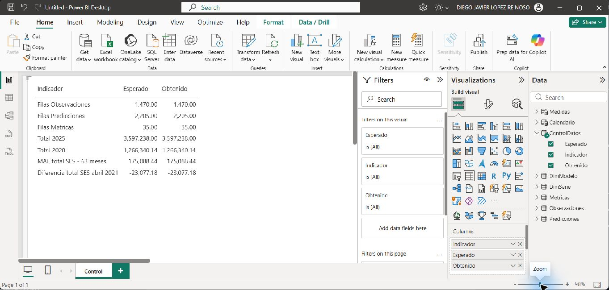

# Lab 12 — Importación y modelo de datos en Power BI

**Responsable:** Diego. **Versión del informe:** v0.1. **Fecha:** 5 de noviembre de 2026.

## 1. Alcance y estado

Esta entrega cubre A5 del avance y los apartados 4.4 y 4.5 del documento de diseño. Se importaron las series y resultados existentes, sin entrenar modelos ni modificar `insumos/` o `app/`. Las visualizaciones V5–V8 corresponden a la segunda sesión; V1/V2 y el diseño de navegación corresponden a Hugo.

El modelo fue construido y consultado en Power BI Desktop. El usuario guardó el archivo el 5 de noviembre a las 15:22. Se reabrió desde el repositorio en una instancia nueva, iniciada a las 15:23:36; las consultas de control devolvieron los mismos resultados y las siete relaciones persistieron. La estructura ZIP del archivo pasó la comprobación de integridad y contiene el modelo, la página Control y su visual de tabla.

## 2. Entorno y reproducción

- Windows; Power BI Desktop **2.159.1231.0 64-bit (October 2026)**, verificado en «About».
- Rama `lab12`, actualizada antes de iniciar.
- Modo de almacenamiento Import. Fecha y hora automáticas desactivadas para el archivo actual.
- Archivo previsto: `powerbi/observatorio_turismo.pbix`.
- Comparación histórica: rama `lab10`; `lab11` cambió G6/G7 y retiró G8.

Abrir el `.pbix` en Power BI Desktop. Para cambiar de equipo: «Transform data > Edit parameters», cambiar `RutaInsumos` por la carpeta absoluta `insumos` terminada en `\`, aplicar los cambios y ejecutar «Refresh». Mantener las subcarpetas `series` y `resultados/predicciones`. Las fórmulas M contienen explícitamente `en-US`, independientemente del idioma de Windows.

### Parámetro `RutaInsumos`

Tipo Texto, obligatorio. Ruta utilizada:

```text
C:\Users\djlop\OneDrive\DIEGO\UVG\2026\segundo semestre\COMPARTIDOS\CC3084-DATA-SCIENCE\insumos\
```

## 3. Fuentes y preparación (4.4)

| Tabla | Fuente | Grano | Filas verificadas |
|---|---|---|---:|
| Observaciones | `insumos/series/serie_<clave>.csv` | Serie y mes | 1.470 |
| Predicciones | `insumos/resultados/predicciones/<serie>_<modelo>.csv` | Serie, modelo y mes | 2.205 |
| Metricas | `insumos/resultados/metricas_modelos.csv` | Serie y modelo, período completo | 35 |

Observaciones cubre enero de 2009 a junio de 2026; predicciones, abril de 2021 a junio de 2026. Los hechos mensuales se relacionan con el primer día del mes. Los archivos se leen con UTF-8 y delimitador coma. Fechas como fecha; valores como número decimal; `mape_excluidos` como entero y `mejor` como lógico. No se redondean, imputan ni agregan las filas durante la importación.

### Observaciones — Power Query

```m
let
    Archivos = Table.SelectRows(Folder.Files(RutaInsumos & "series"), each [Extension] = ".csv"),
    ConClave = Table.AddColumn(Archivos, "serie_clave", each Text.BetweenDelimiters([Name], "serie_", ".csv"), type text),
    ConDatos = Table.AddColumn(ConClave, "Datos", each Table.PromoteHeaders(Csv.Document([Content], [Delimiter = ",", Encoding = 65001]))),
    Expandido = Table.ExpandTableColumn(Table.SelectColumns(ConDatos, {"serie_clave", "Datos"}), "Datos", {"fecha", "viajeros"}),
    Tipos = Table.TransformColumnTypes(Expandido, {{"fecha", type date}, {"viajeros", type number}}, "en-US")
in
    Tipos
```

### Predicciones — Power Query

```m
let
    Modelos = {"sarima", "holt_winters", "ses", "seasonal_naive", "prophet"},
    Archivos = Table.SelectRows(Folder.Files(RutaInsumos & "resultados\predicciones"), each [Extension] = ".csv"),
    ConModelo = Table.AddColumn(Archivos, "modelo_clave", each List.First(List.Select(Modelos, (m) => Text.EndsWith([Name], "_" & m & ".csv"))), type text),
    ConSerie = Table.AddColumn(ConModelo, "serie_clave", each Text.Start([Name], Text.Length([Name]) - Text.Length([modelo_clave]) - 5), type text),
    ConDatos = Table.AddColumn(ConSerie, "Datos", each Table.PromoteHeaders(Csv.Document([Content], [Delimiter = ",", Encoding = 65001]))),
    Expandido = Table.ExpandTableColumn(Table.SelectColumns(ConDatos, {"serie_clave", "modelo_clave", "Datos"}), "Datos", {"fecha", "prediccion"}),
    Tipos = Table.TransformColumnTypes(Expandido, {{"fecha", type date}, {"prediccion", type number}}, "en-US")
in
    Tipos
```

### Metricas — Power Query

```m
let
    Origen = Csv.Document(File.Contents(RutaInsumos & "resultados\metricas_modelos.csv"), [Delimiter = ",", Encoding = 65001, QuoteStyle = QuoteStyle.Csv]),
    Columnas = Table.SelectColumns(Table.PromoteHeaders(Origen), {"serie", "modelo", "mae", "rmse", "mape", "mape_excluidos", "mejor"}),
    Renombradas = Table.RenameColumns(Columnas, {{"serie", "serie_clave"}, {"modelo", "modelo_clave"}}),
    Tipos = Table.TransformColumnTypes(Renombradas, {{"mae", type number}, {"rmse", type number}, {"mape", type number}, {"mape_excluidos", Int64.Type}, {"mejor", type logical}}, "en-US")
in
    Tipos
```

Los nombres de archivo conservan las claves originales. En Predicciones se reconoce el sufijo de uno de los cinco modelos, evitando dividir arbitrariamente por guiones bajos. Metricas conserva MAE, RMSE, MAPE, exclusiones y el indicador de mejor modelo; `order`, AIC y BIC no se incorporan ni se completan.

### Dimensiones

Se crearon como tablas constantes de Power Query, equivalentes a «Enter data». El usuario confirmó numerar según la secuencia del contexto.

**DimSerie**

```m
#table(type table [clave = text, nombre = text, grupo = text, orden = Int64.Type], {{"total", "Total", "Total", 1}, {"via_aerea", "Vía Aérea", "Vía de ingreso", 2}, {"via_terrestre", "Vía Terrestre", "Vía de ingreso", 3}, {"via_maritima", "Vía Marítima", "Vía de ingreso", 4}, {"pais_el_salvador", "El Salvador", "País de residencia", 5}, {"pais_estados_unidos", "Estados Unidos", "País de residencia", 6}, {"pais_honduras", "Honduras", "País de residencia", 7}})
```

**DimModelo**

```m
#table(type table [clave = text, nombre = text, orden = Int64.Type], {{"sarima", "SARIMA", 1}, {"holt_winters", "Holt-Winters", 2}, {"ses", "Suavizamiento exponencial simple (SES)", 3}, {"seasonal_naive", "Referencia estacional (Seasonal Naive)", 4}, {"prophet", "Prophet", 5}})
```

`nombre` se ordena por `orden` en ambas dimensiones. Los grupos de DimSerie son Total, Vía de ingreso y País de residencia. Las tres vías suman el total; los tres países no representan todos los mercados.

### Calendario

```dax
Calendario =
ADDCOLUMNS (
    CALENDAR ( DATE ( 2009, 1, 1 ), DATE ( 2026, 12, 31 ) ),
    "Año", YEAR ( [Date] ),
    "Trimestre", "T" & QUARTER ( [Date] ),
    "MesNum", MONTH ( [Date] ),
    "Mes", FORMAT ( [Date], "mmm", "es-ES" )
)
```

Tabla de fechas marcada con `Date`; calendario diario con años completos, del 01/01/2009 al 31/12/2026. `Mes` se ordena por `MesNum`; jerarquía Año > Trimestre > Mes. La cobertura del calendario no significa que existan observaciones en todos sus días o meses.

## 4. Relaciones y prevención de duplicaciones (4.5)

| Dimensión, lado uno | Tabla, lado varios |
|---|---|
| DimSerie[clave] | Observaciones[serie_clave] |
| DimSerie[clave] | Predicciones[serie_clave] |
| DimSerie[clave] | Metricas[serie_clave] |
| DimModelo[clave] | Predicciones[modelo_clave] |
| DimModelo[clave] | Metricas[modelo_clave] |
| Calendario[Date] | Observaciones[fecha] |
| Calendario[Date] | Predicciones[fecha] |

Las siete relaciones están activas, con filtro unidireccional de la dimensión al hecho. No existen relaciones entre hechos. Metricas no tiene relación temporal: sus valores corresponden a los 63 meses completos, no al período escogido en Calendario.

Se verificaron cero duplicados en las claves compuestas de los tres hechos, siete series y cinco modelos. Las consultas de claves sin correspondencia devolvieron conjuntos vacíos (DAX COUNTROWS devuelve BLANK para estos conjuntos). No se unen observaciones con las cinco predicciones en una tabla plana, por lo que no se multiplica el observado por el número de modelos.

## 5. Medidas DAX y finalidad

Las cuatro medidas están en una tabla independiente `Medidas`. Se intentó ubicarlas en Observaciones, pero Power BI rechazó `Viajeros` por coincidir, sin distinguir mayúsculas, con la columna `viajeros`. Las instrucciones permiten una tabla de medidas; se mantuvieron los nombres y fórmulas originales. La columna auxiliar de Medidas está oculta y esta tabla no tiene relaciones.

```dax
Viajeros = SUM ( Observaciones[viajeros] )

Viajeros serie =
IF (
    HASONEVALUE ( DimSerie[clave] ),
    [Viajeros],
    CALCULATE ( [Viajeros], REMOVEFILTERS ( DimSerie ), DimSerie[clave] = "total" )
)

Estimado =
IF (
    HASONEVALUE ( DimSerie[clave] ) && HASONEVALUE ( DimModelo[clave] ),
    SUM ( Predicciones[prediccion] )
)

Diferencia =
SUMX (
    VALUES ( Calendario[Date] ),
    VAR o = [Viajeros]
    VAR p = [Estimado]
    RETURN IF ( NOT ISBLANK ( o ) && NOT ISBLANK ( p ), o - p )
)
```

- **Viajeros:** suma observaciones en el contexto seleccionado; requiere controlar la serie para no sumar grupos incompatibles.
- **Viajeros serie:** usa la única serie seleccionada; con ninguna o varias series devuelve Total. La selección múltiple no se interpreta como suma de las series elegidas.
- **Estimado:** devuelve valores únicamente con una serie y un modelo; vacío en selecciones ambiguas.
- **Diferencia:** observado menos estimado, sumado solo en fechas con ambos valores; no convierte ausencia en cero.

## 6. Validación en Power BI

Las consultas DAX se ejecutaron contra el modelo abierto mediante el MCP local. Sus resultados, consultas y huellas de los CSV están en [01_diego_validacion.json](01_diego_validacion.json).

| Control | Esperado | Obtenido en Power BI |
|---|---:|---:|
| Filas Observaciones | 1.470 | 1.470 |
| Filas Predicciones | 2.205 | 2.205 |
| Filas Metricas | 35 | 35 |
| Total 2025 | 3.597.238 | 3.597.237,9999999995 |
| Total 2020, redondeado | 1.266.340 | 1.266.340,1437961974 |
| MAE total / SES | 175.088,44 | 175.088,43650293106 |
| Diferencia total / SES / abril 2021 | −23.077,18 | −23.077,1845384029 |
| Viajeros serie sin selección, año 2025 | Total 2025 | 3.597.237,9999999995 |
| Estimado sin selección / múltiples modelos | Vacío | BLANK |
| Diferencia total / SES, año 2010 | Vacío | BLANK |
| Duplicados por clave en cada hecho | 0 | 0 / 0 / 0 |

Las diferencias de presentación provienen del redondeo y de la representación binaria de números decimales. El total de 2020 ya tiene fracciones en los CSV; no se reemplazó por el entero del contexto.

Se consultaron también los siete totales por serie de 2025, los cuatro trimestres de 2020 y la variación interanual de enero de 2025; los resultados completos se conservan en la evidencia JSON.

### Página Control

Contiene una tabla con Indicador, Esperado y Obtenido, alimentada por `ControlDatos`, tabla calculada desconectada. Sus siete controles se recalculan al actualizar el modelo, no al mover segmentadores. Es un diagnóstico técnico, no cuenta como visualización analítica del laboratorio. Hugo deberá ocultar esta página en la versión final.




## 7. Limitaciones y continuación

- Las predicciones se refieren a meses históricos, sin intervalos de confianza; los CSV no documentan una separación independiente entre entrenamiento y evaluación.
- Un menor error histórico no garantiza precisión futura.
- Las métricas importadas resumen abril de 2021 a junio de 2026. No deben presentarse como métricas recalculadas al filtrar fechas; la equivalencia con el G7 dinámico de Lab 10 queda para la especificación de modelos de la segunda sesión.
- El indicador `mejor` proviene del archivo original; no se recalcula para nuevas selecciones.
- Años incompletos, por ejemplo 2026, no deben compararse como si tuvieran doce meses.
- Guardado y reapertura verificados. La actualización completa del modelo se ejecutó antes del guardado; los conteos y valores persistidos se verificaron de nuevo en la instancia reabierta.
