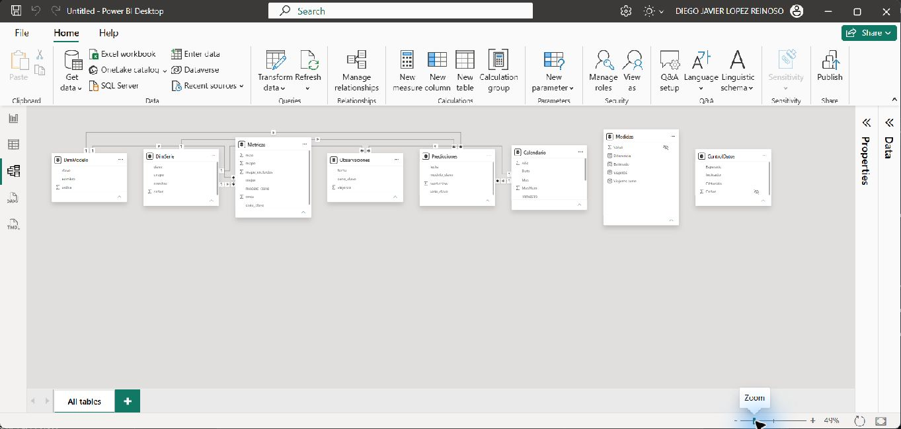
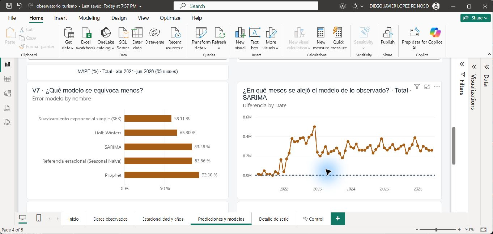
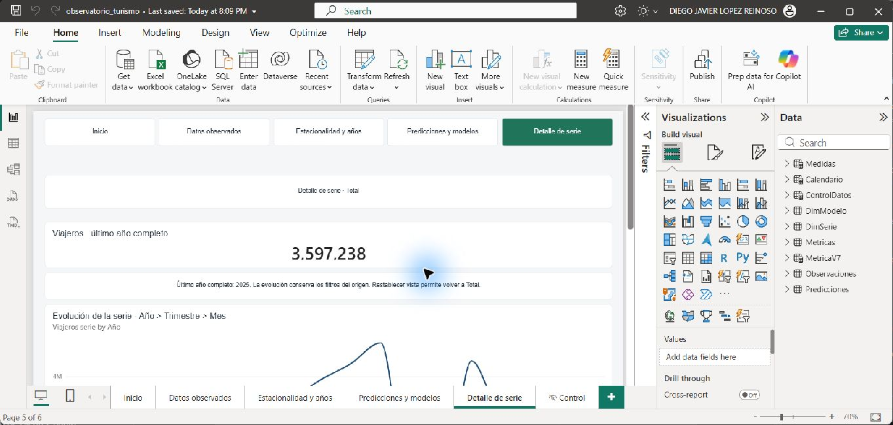

# Lab 12 — Importación y modelo de datos en Power BI

**Responsable:** Diego. **Versión del informe:** v1.0 congelada tras la validación técnica; pruebas humanas pendientes. **Fecha:** 5 de noviembre de 2026.

## 1. Alcance y estado

Esta entrega cubre A5 del avance y los apartados 4.4 y 4.5 del documento de diseño. Se importaron las series y resultados existentes, sin entrenar modelos ni modificar `insumos/` o `app/`. Este documento conserva la evidencia inicial y añade el cierre de V6–V8. Hugo entregó V1–V5 y la navegación en v0.3; Diego incorpora la página de modelos.

El modelo fue construido y consultado en Power BI Desktop. El usuario guardó el archivo el 5 de noviembre a las 15:22. Se reabrió desde el repositorio en una instancia nueva, iniciada a las 15:23:36; las consultas de control devolvieron los mismos resultados y las siete relaciones persistieron. La estructura ZIP del archivo pasó la comprobación de integridad y contiene el modelo, la página Control y su visual de tabla.

## 2. Entorno y reproducción

- Windows; Power BI Desktop **2.159.1231.0 64-bit (October 2026)**, verificado en «About».
- Rama `lab12`, actualizada antes de iniciar.
- Modo de almacenamiento Import. Fecha y hora automáticas desactivadas para el archivo actual.
- Archivo previsto: `powerbi/observatorio_turismo.pbix`.
- Comparación histórica: rama `lab10`; `lab11` cambió G6/G7 y retiró G8.

Abrir el `.pbix` en Power BI Desktop. Para cambiar de equipo: «Transform data > Edit parameters», cambiar `RutaInsumos` por la carpeta absoluta `insumos` terminada en `\`, aplicar los cambios y ejecutar «Refresh». Mantener las subcarpetas `series` y `resultados/predicciones`. Las fórmulas M contienen explícitamente `en-US`, independientemente del idioma de Windows.

### Parámetro `RutaInsumos`

Tipo Texto, obligatorio. Ruta utilizada:

```text
C:\Users\djlop\OneDrive\DIEGO\UVG\2026\segundo semestre\COMPARTIDOS\CC3084-DATA-SCIENCE\insumos\
```

## 3. Fuentes y preparación (4.4)

| Tabla | Fuente | Grano | Filas verificadas |
|---|---|---|---:|
| Observaciones | `insumos/series/serie_<clave>.csv` | Serie y mes | 1.470 |
| Predicciones | `insumos/resultados/predicciones/<serie>_<modelo>.csv` | Serie, modelo y mes | 2.205 |
| Metricas | `insumos/resultados/metricas_modelos.csv` | Serie y modelo, período completo | 35 |

Observaciones cubre enero de 2009 a junio de 2026; predicciones, abril de 2021 a junio de 2026. Los hechos mensuales se relacionan con el primer día del mes. Los archivos se leen con UTF-8 y delimitador coma. Fechas como fecha; valores como número decimal; `mape_excluidos` como entero y `mejor` como lógico. No se redondean, imputan ni agregan las filas durante la importación.

### Observaciones — Power Query

```m
let
    Archivos = Table.SelectRows(Folder.Files(RutaInsumos & "series"), each [Extension] = ".csv"),
    ConClave = Table.AddColumn(Archivos, "serie_clave", each Text.BetweenDelimiters([Name], "serie_", ".csv"), type text),
    ConDatos = Table.AddColumn(ConClave, "Datos", each Table.PromoteHeaders(Csv.Document([Content], [Delimiter = ",", Encoding = 65001]))),
    Expandido = Table.ExpandTableColumn(Table.SelectColumns(ConDatos, {"serie_clave", "Datos"}), "Datos", {"fecha", "viajeros"}),
    Tipos = Table.TransformColumnTypes(Expandido, {{"fecha", type date}, {"viajeros", type number}}, "en-US")
in
    Tipos
```

### Predicciones — Power Query

```m
let
    Modelos = {"sarima", "holt_winters", "ses", "seasonal_naive", "prophet"},
    Archivos = Table.SelectRows(Folder.Files(RutaInsumos & "resultados\predicciones"), each [Extension] = ".csv"),
    ConModelo = Table.AddColumn(Archivos, "modelo_clave", each List.First(List.Select(Modelos, (m) => Text.EndsWith([Name], "_" & m & ".csv"))), type text),
    ConSerie = Table.AddColumn(ConModelo, "serie_clave", each Text.Start([Name], Text.Length([Name]) - Text.Length([modelo_clave]) - 5), type text),
    ConDatos = Table.AddColumn(ConSerie, "Datos", each Table.PromoteHeaders(Csv.Document([Content], [Delimiter = ",", Encoding = 65001]))),
    Expandido = Table.ExpandTableColumn(Table.SelectColumns(ConDatos, {"serie_clave", "modelo_clave", "Datos"}), "Datos", {"fecha", "prediccion"}),
    Tipos = Table.TransformColumnTypes(Expandido, {{"fecha", type date}, {"prediccion", type number}}, "en-US")
in
    Tipos
```

### Metricas — Power Query

```m
let
    Origen = Csv.Document(File.Contents(RutaInsumos & "resultados\metricas_modelos.csv"), [Delimiter = ",", Encoding = 65001, QuoteStyle = QuoteStyle.Csv]),
    Columnas = Table.SelectColumns(Table.PromoteHeaders(Origen), {"serie", "modelo", "mae", "rmse", "mape", "mape_excluidos", "mejor"}),
    Renombradas = Table.RenameColumns(Columnas, {{"serie", "serie_clave"}, {"modelo", "modelo_clave"}}),
    Tipos = Table.TransformColumnTypes(Renombradas, {{"mae", type number}, {"rmse", type number}, {"mape", type number}, {"mape_excluidos", Int64.Type}, {"mejor", type logical}}, "en-US")
in
    Tipos
```

Los nombres de archivo conservan las claves originales. En Predicciones se reconoce el sufijo de uno de los cinco modelos, evitando dividir arbitrariamente por guiones bajos. Metricas conserva MAE, RMSE, MAPE, exclusiones y el indicador de mejor modelo; `order`, AIC y BIC no se incorporan ni se completan.

### Dimensiones

Se crearon como tablas constantes de Power Query, equivalentes a «Enter data». El usuario confirmó numerar según la secuencia del contexto.

**DimSerie**

```m
#table(type table [clave = text, nombre = text, grupo = text, orden = Int64.Type], {{"total", "Total", "Total", 1}, {"via_aerea", "Vía Aérea", "Vía de ingreso", 2}, {"via_terrestre", "Vía Terrestre", "Vía de ingreso", 3}, {"via_maritima", "Vía Marítima", "Vía de ingreso", 4}, {"pais_el_salvador", "El Salvador", "País de residencia", 5}, {"pais_estados_unidos", "Estados Unidos", "País de residencia", 6}, {"pais_honduras", "Honduras", "País de residencia", 7}})
```

**DimModelo**

```m
#table(type table [clave = text, nombre = text, orden = Int64.Type], {{"sarima", "SARIMA", 1}, {"holt_winters", "Holt-Winters", 2}, {"ses", "Suavizamiento exponencial simple (SES)", 3}, {"seasonal_naive", "Referencia estacional (Seasonal Naive)", 4}, {"prophet", "Prophet", 5}})
```

`nombre` se ordena por `orden` en ambas dimensiones. Los grupos de DimSerie son Total, Vía de ingreso y País de residencia. Las tres vías suman el total; los tres países no representan todos los mercados.

### Calendario

```dax
Calendario =
ADDCOLUMNS (
    CALENDAR ( DATE ( 2009, 1, 1 ), DATE ( 2026, 12, 31 ) ),
    "Año", YEAR ( [Date] ),
    "Trimestre", "T" & QUARTER ( [Date] ),
    "MesNum", MONTH ( [Date] ),
    "Mes", FORMAT ( [Date], "mmm", "es-ES" )
)
```

Tabla de fechas marcada con `Date`; calendario diario con años completos, del 01/01/2009 al 31/12/2026. `Mes` se ordena por `MesNum`; jerarquía Año > Trimestre > Mes. La cobertura del calendario no significa que existan observaciones en todos sus días o meses.

## 4. Relaciones y prevención de duplicaciones (4.5)

| Dimensión, lado uno | Tabla, lado varios |
|---|---|
| DimSerie[clave] | Observaciones[serie_clave] |
| DimSerie[clave] | Predicciones[serie_clave] |
| DimSerie[clave] | Metricas[serie_clave] |
| DimModelo[clave] | Predicciones[modelo_clave] |
| DimModelo[clave] | Metricas[modelo_clave] |
| Calendario[Date] | Observaciones[fecha] |
| Calendario[Date] | Predicciones[fecha] |

Las siete relaciones están activas, con filtro unidireccional de la dimensión al hecho. No existen relaciones entre hechos. Metricas no tiene relación temporal: sus valores corresponden a los 63 meses completos, no al período escogido en Calendario.

Se verificaron cero duplicados en las claves compuestas de los tres hechos, siete series y cinco modelos. Las consultas de claves sin correspondencia devolvieron conjuntos vacíos (DAX COUNTROWS devuelve BLANK para estos conjuntos). No se unen observaciones con las cinco predicciones en una tabla plana, por lo que no se multiplica el observado por el número de modelos.

## 5. Medidas DAX y finalidad

Las cuatro medidas están en una tabla independiente `Medidas`. Se intentó ubicarlas en Observaciones, pero Power BI rechazó `Viajeros` por coincidir, sin distinguir mayúsculas, con la columna `viajeros`. Las instrucciones permiten una tabla de medidas; se mantuvieron los nombres y fórmulas originales. La columna auxiliar de Medidas está oculta y esta tabla no tiene relaciones.

```dax
Viajeros = SUM ( Observaciones[viajeros] )

Viajeros serie =
IF (
    HASONEVALUE ( DimSerie[clave] ),
    [Viajeros],
    CALCULATE ( [Viajeros], REMOVEFILTERS ( DimSerie ), DimSerie[clave] = "total" )
)

Estimado =
IF (
    HASONEVALUE ( DimSerie[clave] ) && HASONEVALUE ( DimModelo[clave] ),
    SUM ( Predicciones[prediccion] )
)

Diferencia =
SUMX (
    VALUES ( Calendario[Date] ),
    VAR o = [Viajeros]
    VAR p = [Estimado]
    RETURN IF ( NOT ISBLANK ( o ) && NOT ISBLANK ( p ), o - p )
)
```

- **Viajeros:** suma observaciones en el contexto seleccionado; requiere controlar la serie para no sumar grupos incompatibles.
- **Viajeros serie:** usa la única serie seleccionada; con ninguna o varias series devuelve Total. La selección múltiple no se interpreta como suma de las series elegidas.
- **Estimado:** devuelve valores únicamente con una serie y un modelo; vacío en selecciones ambiguas.
- **Diferencia:** observado menos estimado, sumado solo en fechas con ambos valores; no convierte ausencia en cero.

## 6. Validación en Power BI

Las consultas DAX se ejecutaron contra el modelo abierto mediante el MCP local. Sus resultados, consultas y huellas de los CSV están en [01_diego_validacion.json](01_diego_validacion.json).

| Control | Esperado | Obtenido en Power BI |
|---|---:|---:|
| Filas Observaciones | 1.470 | 1.470 |
| Filas Predicciones | 2.205 | 2.205 |
| Filas Metricas | 35 | 35 |
| Total 2025 | 3.597.238 | 3.597.237,9999999995 |
| Total 2020, redondeado | 1.266.340 | 1.266.340,1437961974 |
| MAE total / SES | 175.088,44 | 175.088,43650293106 |
| Diferencia total / SES / abril 2021 | −23.077,18 | −23.077,1845384029 |
| Viajeros serie sin selección, año 2025 | Total 2025 | 3.597.237,9999999995 |
| Estimado sin selección / múltiples modelos | Vacío | BLANK |
| Diferencia total / SES, año 2010 | Vacío | BLANK |
| Duplicados por clave en cada hecho | 0 | 0 / 0 / 0 |

Las diferencias de presentación provienen del redondeo y de la representación binaria de números decimales. El total de 2020 ya tiene fracciones en los CSV; no se reemplazó por el entero del contexto.

Se consultaron también los siete totales por serie de 2025, los cuatro trimestres de 2020 y la variación interanual de enero de 2025; los resultados completos se conservan en la evidencia JSON.

### Página Control

Contiene una tabla con Indicador, Esperado y Obtenido, alimentada por `ControlDatos`, tabla calculada desconectada. Sus siete controles se recalculan al actualizar el modelo, no al mover segmentadores. Es un diagnóstico técnico, no cuenta como visualización analítica del laboratorio. Hugo deberá ocultar esta página en la versión final.




## 7. Limitaciones y continuación

- Las predicciones se refieren a meses históricos, sin intervalos de confianza; los CSV no documentan una separación independiente entre entrenamiento y evaluación.
- Un menor error histórico no garantiza precisión futura.
- Las métricas importadas resumen abril de 2021 a junio de 2026 y no responden al filtro de fechas. Esto reproduce G7 de Lab 10: llama a calculate_errors(series_key) sin fechas. Se corrigió la observación preliminar que lo describía como dinámico por período.
- El indicador `mejor` proviene del archivo original; no se recalcula para nuevas selecciones.
- Años incompletos, por ejemplo 2026, no deben compararse como si tuvieran doce meses.
- Guardado y reapertura verificados. La actualización completa del modelo se ejecutó antes del guardado; los conteos y valores persistidos se verificaron de nuevo en la instancia reabierta.


## 8. Cierre de datos y modelos — 8 de noviembre

Se partió de v0.3 de Hugo, commit `645d311`, conservando sus páginas y los CSV. Se respaldó el PBIX recibido y la copia local previa, que estaba modificada. Esa copia local también permanece en un stash identificado; no se mezcló con v0.3.

V6 superpone observado y cinco medidas por modelo; inicialmente SARIMA, Holt-Winters y SES, con Total y abril de 2021–junio de 2026. El selector múltiple solo cambia V6. Limpiar su selección equivale a mostrar los cinco modelos; la leyenda puede conservar el nombre de medidas cuyo valor quedó vacío. Los colores identifican cada estimación y el observado azul.

V7 compara cinco modelos sobre los mismos 63 meses, con selector independiente de MAE, RMSE o MAPE. Metricas no tiene relación con Calendario. Los modelos seleccionados para V6 y las fechas no filtran V7; la serie sí. `MetricaV7` es una tabla desconectada, ordenada por Orden, con métrica, unidad y explicación. El formato dinámico muestra MAPE como porcentaje literal, pues los CSV ya contienen valores como 58,11 y no 0,5811.

V8 utiliza Diferencia y un modelo único independiente, SARIMA por defecto. Comparte serie y fechas con V6; no recibe el selector múltiple. Se conservó la línea con marcadores de la ficha detallada de Ernesto, en lugar de las columnas mencionadas en las instrucciones resumidas. La referencia en cero y el texto explican el signo. La tabla de métricas y el glosario son complementarios y no cuentan dentro de las ocho visualizaciones.

### Ajustes surgidos de la comprobación real

- Nota V6 requería ordenar CONCATENATEX mediante CALCULATE(MIN(DimModelo[orden])): la fórmula original producía un error semántico.
- El formato dinámico de Error modelo requiere dejar vacío el formato estático; definir ambos produce un error de guardado.
- Se abrevia Subtitulo V7 para mostrar completos métrica, unidad, serie y período sin truncamiento. El glosario conserva las explicaciones.
- V7 incorpora DimSerie[nombre] en información sobre herramientas con el alias nativo único Serie. Sin ese alias, Desktop rechazó la consulta por dos campos llamados nombre. Después de corregirlo, se probó el acceso real al detalle y este recibió Total, con 3.597.238 viajeros del último año completo.

### DAX incorporado por Diego

**Estimado serie** — Línea de estimación por modelo, respetando el selector.

```dax
Estimado serie =
IF (
    HASONEVALUE ( DimSerie[clave] ),
    [Estimado],
    CALCULATE ( [Estimado], REMOVEFILTERS ( DimSerie ), DimSerie[clave] = "total" )
)
```

**Observado V6** — Control, texto o resultado de la página de modelos; conserva el contexto e interacciones descritos arriba.

```dax
Observado V6 =
IF ( NOT ISEMPTY ( Predicciones ), [Viajeros serie] )
```

**Estimado SARIMA** — Línea de estimación por modelo, respetando el selector.

```dax
Estimado SARIMA =
CALCULATE ( [Estimado serie], KEEPFILTERS ( DimModelo[clave] = "sarima" ) )
```

**Estimado Holt-Winters** — Línea de estimación por modelo, respetando el selector.

```dax
Estimado Holt-Winters =
CALCULATE ( [Estimado serie], KEEPFILTERS ( DimModelo[clave] = "holt_winters" ) )
```

**Estimado SES** — Línea de estimación por modelo, respetando el selector.

```dax
Estimado SES =
CALCULATE ( [Estimado serie], KEEPFILTERS ( DimModelo[clave] = "ses" ) )
```

**Estimado Seasonal Naive** — Línea de estimación por modelo, respetando el selector.

```dax
Estimado Seasonal Naive =
CALCULATE ( [Estimado serie], KEEPFILTERS ( DimModelo[clave] = "seasonal_naive" ) )
```

**Estimado Prophet** — Línea de estimación por modelo, respetando el selector.

```dax
Estimado Prophet =
CALCULATE ( [Estimado serie], KEEPFILTERS ( DimModelo[clave] = "prophet" ) )
```

**Nota V6** — Control, texto o resultado de la página de modelos; conserva el contexto e interacciones descritos arriba.

```dax
Nota V6 =
VAR Meses = COUNTROWS ( FILTER ( VALUES ( Calendario[Date] ), NOT ISBLANK ( [Observado V6] ) ) )
VAR Modelos = CONCATENATEX ( VALUES ( DimModelo[nombre] ), DimModelo[nombre], ", ", CALCULATE ( MIN ( DimModelo[orden] ) ), ASC )
RETURN
    [Serie elegida] & " · " & Modelos & ". " & Meses & " meses con dato registrado y estimación. "
        & "Las estimaciones son resultados existentes (insumos/resultados/predicciones); no se entrenó ningún modelo. "
        & "Corresponden a meses ya registrados: no son un pronóstico de meses futuros ni incluyen intervalos de confianza."
```

**Mensaje V6** — Control, texto o resultado de la página de modelos; conserva el contexto e interacciones descritos arriba.

```dax
Mensaje V6 =
IF (
    ISBLANK ( [Observado V6] ),
    "No hay meses con dato registrado y estimación en este periodo. Amplíe las fechas o cambie los modelos.",
    ""
)
```

**Error modelo** — Control, texto o resultado de la página de modelos; conserva el contexto e interacciones descritos arriba.

```dax
Error modelo =
VAR Metrica = SELECTEDVALUE ( MetricaV7[Metrica], "MAE" )
VAR Serie = IF ( HASONEVALUE ( DimSerie[clave] ), SELECTEDVALUE ( DimSerie[clave] ), "total" )
RETURN
    CALCULATE (
        SWITCH ( Metrica, "MAE", SUM ( Metricas[mae] ), "RMSE", SUM ( Metricas[rmse] ), "MAPE", SUM ( Metricas[mape] ) ),
        REMOVEFILTERS ( DimSerie ),
        DimSerie[clave] = Serie
    )
```

Formato dinámico:

```dax
IF ( SELECTEDVALUE ( MetricaV7[Metrica], "MAE" ) = "MAPE", "0.00 \%", "#,0.00" )
```

**Subtitulo V7** — Control, texto o resultado de la página de modelos; conserva el contexto e interacciones descritos arriba.

```dax
Subtitulo V7 =
VAR M = SELECTEDVALUE(MetricaV7[Metrica], "MAE") VAR E = CALCULATE(MAX(Metricas[mape_excluidos]),REMOVEFILTERS(DimModelo)) RETURN M & " (" & SELECTEDVALUE(MetricaV7[Unidad], "viajeros") & ") · " & [Serie elegida] & " · abr-2021–jun-2026 (63 meses)" & IF(M = "MAPE" && E > 0, " · excluidos: " & E, "")
```

**Mensaje V7** — Control, texto o resultado de la página de modelos; conserva el contexto e interacciones descritos arriba.

```dax
Mensaje V7 =
IF ( ISBLANK ( [Error modelo] ), "No hay datos coincidentes para comparar los modelos de esta selección.", "" )
```

**Titulo V8** — Control, texto o resultado de la página de modelos; conserva el contexto e interacciones descritos arriba.

```dax
Titulo V8 =
"¿En qué meses se alejó el modelo de lo observado? · " & [Serie elegida] & " · "
    & SELECTEDVALUE ( DimModelo[nombre], "elija un modelo" )
```

**Mensaje V8** — Control, texto o resultado de la página de modelos; conserva el contexto e interacciones descritos arriba.

```dax
Mensaje V8 =
IF (
    ISBLANK ( [Diferencia] ),
    "No hay datos observados y estimados coincidentes para esta selección. Amplíe las fechas o cambie el modelo.",
    ""
)
```

**MAE modelo** — Control, texto o resultado de la página de modelos; conserva el contexto e interacciones descritos arriba.

```dax
MAE modelo =
VAR Serie = SELECTEDVALUE(DimSerie[clave], "total") RETURN CALCULATE(SUM(Metricas[mae]), REMOVEFILTERS(DimSerie), DimSerie[clave] = Serie)
```

**RMSE modelo** — Control, texto o resultado de la página de modelos; conserva el contexto e interacciones descritos arriba.

```dax
RMSE modelo =
VAR Serie = SELECTEDVALUE(DimSerie[clave], "total") RETURN CALCULATE(SUM(Metricas[rmse]), REMOVEFILTERS(DimSerie), DimSerie[clave] = Serie)
```

**MAPE modelo** — Control, texto o resultado de la página de modelos; conserva el contexto e interacciones descritos arriba.

```dax
MAPE modelo =
VAR Serie = SELECTEDVALUE(DimSerie[clave], "total") RETURN CALCULATE(SUM(Metricas[mape]), REMOVEFILTERS(DimSerie), DimSerie[clave] = Serie)
```

### Medidas de Hugo incorporadas desde v0.3

**Color texto V3** — soporte de V1–V5, mensajes y detalle de serie.

```dax
Color texto V3 =
VAR Celdas = SUMMARIZE ( ALLSELECTED ( Calendario ), Calendario[Año], Calendario[MesNum] ) VAR Minimo = MINX ( Celdas, [Viajeros serie] ) VAR Maximo = MAXX ( Celdas, [Viajeros serie] ) RETURN IF ( NOT ISBLANK ( [Viajeros serie] ) && DIVIDE ( [Viajeros serie] - Minimo, Maximo - Minimo, 0 ) >= 0.55, "#FFFFFF", "#1B2733" )
```

**Serie elegida** — soporte de V1–V5, mensajes y detalle de serie.

```dax
Serie elegida =
IF ( HASONEVALUE ( DimSerie[nombre] ), SELECTEDVALUE ( DimSerie[nombre] ), "Total" )
```

**Meses con dato serie** — soporte de V1–V5, mensajes y detalle de serie.

```dax
Meses con dato serie =
COALESCE (
    IF (
        HASONEVALUE ( DimSerie[clave] ),
        COUNT ( Observaciones[viajeros] ),
        CALCULATE ( COUNT ( Observaciones[viajeros] ), REMOVEFILTERS ( DimSerie ), DimSerie[clave] = "total" )
    ),
    0
)
```

**Nota V3** — soporte de V1–V5, mensajes y detalle de serie.

```dax
Nota V3 =
VAR Meses = COUNTROWS ( VALUES ( Calendario[Año] ) ) * 12
VAR ConDato = [Meses con dato serie]
RETURN
    [Serie elegida] & " · " & MIN ( Calendario[Año] ) & "–" & MAX ( Calendario[Año] ) & ". "
        & ConDato & " meses con dato válido; " & ( Meses - ConDato ) & " sin dato (celda vacía, no cero). "
        & "Azul más intenso indica más viajeros. El patrón describe la distribución temporal y no demuestra sus causas."
```

**Mensaje V3** — soporte de V1–V5, mensajes y detalle de serie.

```dax
Mensaje V3 =
IF ( ISBLANK ( [Viajeros serie] ), "No hay datos válidos para esta selección. Cambie la serie o el rango de años.", "" )
```

**Total año completo** — soporte de V1–V5, mensajes y detalle de serie.

```dax
Total año completo =
IF ( [Meses con dato serie] = 12, [Viajeros serie] )
```

**Nota V4** — soporte de V1–V5, mensajes y detalle de serie.

```dax
Nota V4 =
VAR Excluidos =
    FILTER ( VALUES ( Calendario[Año] ), VAR m = [Meses con dato serie] RETURN m > 0 && m < 12 )
VAR Completos =
    COALESCE ( COUNTROWS ( FILTER ( VALUES ( Calendario[Año] ), [Meses con dato serie] = 12 ) ), 0 )
RETURN
    [Serie elegida] & ". Se muestran " & Completos & " años completos, cada uno con doce meses válidos. "
        & IF (
            ISEMPTY ( Excluidos ),
            "No se excluyeron años incompletos.",
            "Se excluyen por estar incompletos: "
                & CONCATENATEX ( Excluidos, Calendario[Año] & " (" & [Meses con dato serie] & " de 12 meses)", "; ", Calendario[Año], ASC )
                & "."
        )
        & " No se suman vías de ingreso con países de residencia."
```

**Mensaje V4** — soporte de V1–V5, mensajes y detalle de serie.

```dax
Mensaje V4 =
IF (
    ISEMPTY ( FILTER ( VALUES ( Calendario[Año] ), [Meses con dato serie] = 12 ) ),
    "No hay años completos para esta selección. Cambie la serie o amplíe el rango de años.",
    ""
)
```

**Viajeros año anterior** — soporte de V1–V5, mensajes y detalle de serie.

```dax
Viajeros año anterior =
CALCULATE ( [Viajeros serie], SAMEPERIODLASTYEAR ( Calendario[Date] ) )
```

**Variación interanual %** — soporte de V1–V5, mensajes y detalle de serie.

```dax
Variación interanual % =
VAR Actual = [Viajeros serie]
VAR Anterior = [Viajeros año anterior]
RETURN
    IF (
        HASONEVALUE ( Calendario[Año] ) && HASONEVALUE ( Calendario[MesNum] )
            && NOT ISBLANK ( Actual ) && NOT ISBLANK ( Anterior ) && Anterior <> 0,
        DIVIDE ( Actual - Anterior, Anterior )
    )
```

**Meses con variación** — soporte de V1–V5, mensajes y detalle de serie.

```dax
Meses con variación =
COALESCE (
    COUNTROWS (
        FILTER ( SUMMARIZE ( Calendario, Calendario[Año], Calendario[MesNum] ), NOT ISBLANK ( [Variación interanual %] ) )
    ),
    0
)
```

**Nota V5** — soporte de V1–V5, mensajes y detalle de serie.

```dax
Nota V5 =
VAR Meses = COUNTROWS ( SUMMARIZE ( Calendario, Calendario[Año], Calendario[MesNum] ) )
VAR Calculados = [Meses con variación]
RETURN
    [Serie elegida] & ". " & Calculados & " meses con variación = (viajeros del mes ÷ mismo mes del año anterior − 1). "
        & "Positivo: más viajeros que un año antes; negativo: menos. "
        & IF ( Meses > Calculados, ( Meses - Calculados ) & " meses sin base válida no se dibujan (no son cero). ", "" )
        & "Si el año anterior tuvo pocos viajeros, como en 2020, el porcentaje puede ser muy grande."
```

**Mensaje V5** — soporte de V1–V5, mensajes y detalle de serie.

```dax
Mensaje V5 =
IF (
    [Meses con variación] = 0,
    "No se puede calcular la variación interanual para ningún mes de esta selección. Elija fechas posteriores al primer año de la serie o cambie la serie.",
    ""
)
```

**Último año completo** — soporte de V1–V5, mensajes y detalle de serie.

```dax
Último año completo =
MAXX ( FILTER ( ALL ( Calendario[Año] ), CALCULATE ( [Meses con dato serie], REMOVEFILTERS ( Calendario ), Calendario[Año] = EARLIER ( Calendario[Año] ) ) = 12 ), Calendario[Año] )
```

**Total último año completo** — soporte de V1–V5, mensajes y detalle de serie.

```dax
Total último año completo =
VAR Anio = [Último año completo] RETURN CALCULATE ( [Viajeros serie], REMOVEFILTERS ( Calendario ), Calendario[Año] = Anio )
```

**Título detalle** — soporte de V1–V5, mensajes y detalle de serie.

```dax
Título detalle =
"Detalle de serie · " & [Serie elegida]
```

**Nota detalle** — soporte de V1–V5, mensajes y detalle de serie.

```dax
Nota detalle =
"Último año completo: " & FORMAT ( [Último año completo], "0" ) & ". La evolución conserva los filtros del origen. Restablecer vista permite volver a Total."
```

### Prueba de actualización desde otra carpeta

Se copió insumos a `TEMP/insumos_prueba_refresco`, conservando sus subcarpetas. Se cambió la expresión del parámetro RutaInsumos mediante MCP, se ejecutó actualización completa y se consultaron los controles. Después se restauró el parámetro a la carpeta original y se volvió a actualizar y consultar. En ambas rutas se conservaron 1.470 observaciones, 2.205 predicciones, 35 métricas y Total 2025 = 3.597.238 al redondear. No se editó la fuente original. El usuario puede reproducir el mismo cambio con Transformar datos > Editar parámetros > RutaInsumos > Aplicar > Actualizar.

Se compararon además las 105 métricas de las 35 combinaciones del modelo abierto contra los CSV, con tolerancia relativa 1e-9. El error de SES y su diferencia de abril coinciden con la ficha. La evidencia está en `01_diego_validacion_final.json`.

La integración de páginas modifica exclusivamente la definición de Predicciones y modelos y su marcador, preserva las demás páginas y comprueba que DataModel sea idéntico durante la escritura del contenedor. Las definiciones de medidas están en `powerbi/medidas_diego.json`; el generador específico es `docs/scripts/lab12_model_pages.py`. Ejecutarlo solo con Desktop cerrado y después de respaldar ajustes manuales de la página de modelos. No modifica ni entrena los modelos predictivos.



### Estado del cierre

La medición humana de T1–T3 y las capturas correspondientes permanecen pendientes. Las comprobaciones de datos y estructura no se presentan como tiempos o resultados de una prueba humana. Véase `05_diego_pruebas.md`.


### Congelación técnica de v1.0

Se reabrió el archivo corregido y se revisaron V1–V8 sin gráficas en error. V7 se probó con MAE y MAPE, conservando sus unidades y el orden; el detalle desde V7 recibió la serie Total. Se conservan Inicio como página activa, Control oculta y los segmentadores iniciales en la definición guardada. Desktop quedó cerrado después de la revisión. El archivo congelado se identifica mediante SHA-256 en `powerbi/version_informe.json`. Las 23 pruebas de diseño/modelos y las 33 pruebas de modelos de Lab 10 pasaron. La ejecución humana de los recorridos y botones, con tiempos y clics, no se da por completada.


