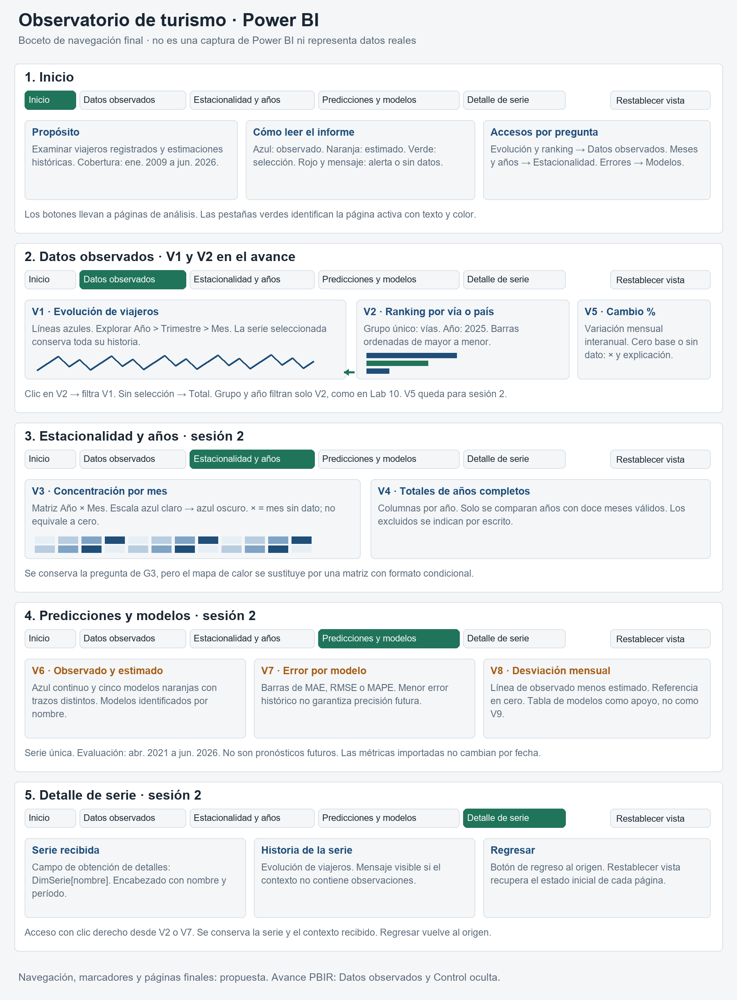
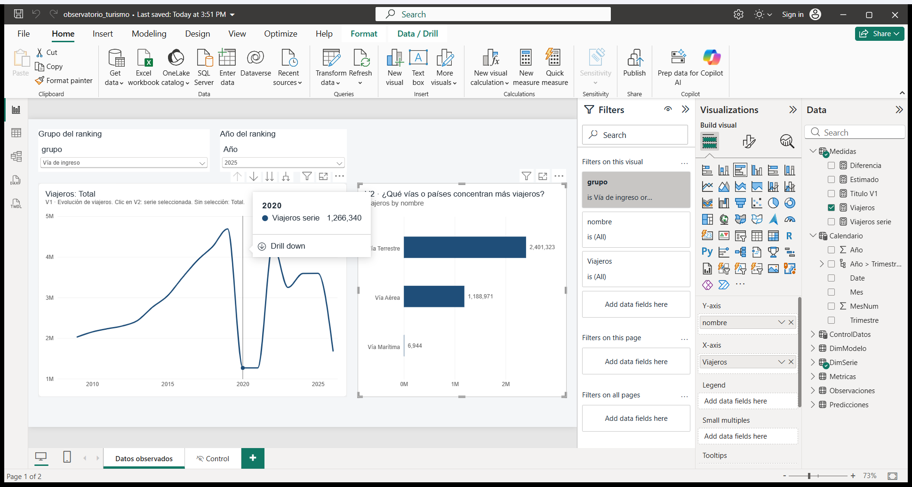
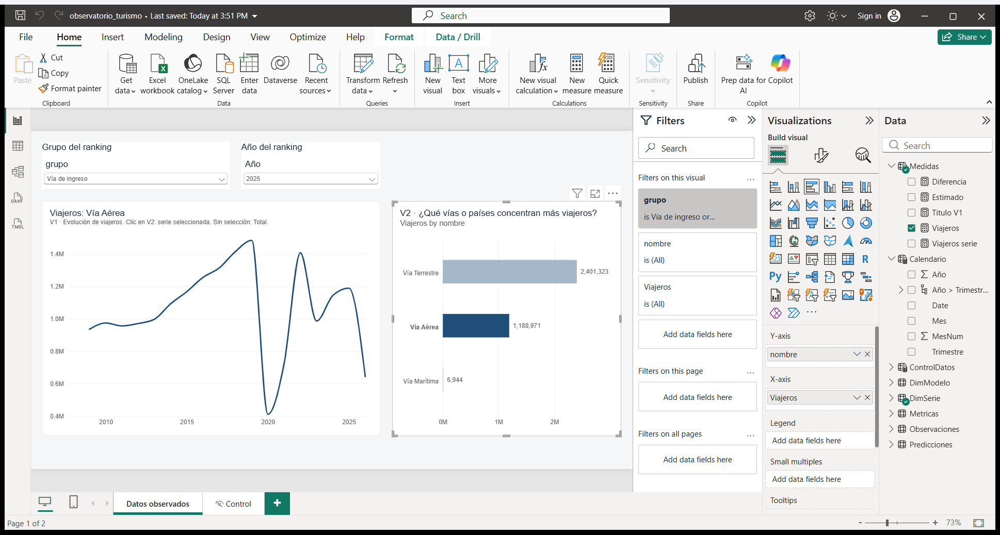

# Lab 12 · Diseño, navegación y visualizaciones enlazadas

**Responsable:** Hugo. **Fecha:** 5 de noviembre de 2026. **Alcance:** avance A2, A4 y A6.

**Estado:** v0.2 local, abierta y guardada con Power BI Desktop. La publicación remota y el envío a Esteban no se han realizado.

## 1. Alcance y archivos

La propuesta conserva las preguntas, fuentes y colores del Lab 10. La consulta histórica se realizó contra la rama `lab10`, no contra `lab11`. No se modificaron `insumos/` ni `app/`, ni se entrenaron modelos.

| Entregable | Archivo |
|---|---|
| Tema importable | `powerbi/tema_observatorio.json` |
| Boceto de las cinco páginas | `docs/figuras/lab12_hugo_boceto.png` |
| Informe con página Datos observados | `powerbi/observatorio_turismo.pbix` |
| Generador de la página PBIR | `docs/scripts/build_lab12_report.py` |
| Generador del boceto | `docs/scripts/draw_lab12_wireframe.py` |
| Pruebas automatizadas | `tests/test_lab12_design.py` |
| Capturas reales | `docs/figuras/lab12_hugo_v1_v2_inicial.png` y `docs/figuras/lab12_hugo_v1_v2_seleccion.png` |

La edición del informe fue autorizada por el usuario tras confirmar el traspaso de Diego a Hugo. Se conservan los datos importados, las relaciones y las cuatro medidas base. Se agregó únicamente la medida de presentación `Titulo V1` desde Power BI Desktop. La copia anterior permanece en `TEMP/observatorio_turismo_antes_hugo.pbix`, fuera del control de versiones.

## 2. Paleta y justificación · A2

| Uso | Color | Justificación |
|---|---|---|
| Datos observados | Azul `#1F4E79` | Color frío y estable para datos registrados. Mantiene el significado del Lab 10. |
| Estimaciones | Naranja `#A65E16` | Contrasta con el azul y separa las estimaciones de las observaciones. |
| Selección activa | Verde `#20745A` | Se reserva para selección y página activa, no para otra serie. |
| Alertas y ausencia de datos | Rojo `#B3261E` | Se acompaña de una advertencia escrita, nunca aparece como otra serie. |
| Fondo | `#F4F6F8` | Separa el lienzo de las tarjetas sin competir con los datos. |
| Tarjetas | Blanco `#FFFFFF` | Mantiene una superficie uniforme para gráficas y texto. |
| Texto principal | `#1B2733` | Facilita la lectura de títulos y cantidades. |
| Texto secundario | `#5B6B7A` | Diferencia las ayudas sin perder contraste. |
| Cuadrícula | `#DDE3E9` | Referencia tenue que no sustituye los ejes ni sus etiquetas. |
| Escala de estacionalidad | `#E7EFF6` → `#1F4E79` | Escala secuencial equivalente a G3 para valores de menor a mayor magnitud. |

El tema contiene los cinco colores de modelos, pero una paleta automática no garantiza su correspondencia con cada modelo. Al construir V6 se asignarán explícitamente los siguientes nombres, colores y trazos:

| Modelo | Color | Trazo del Lab 10 |
|---|---|---|
| SARIMA | `#A65E16` | Guiones |
| Holt-Winters | `#6B3A0C` | Puntos |
| SES | `#C46A12` | Guion y punto |
| Seasonal Naive | `#8A4B12` | Guion largo |
| Prophet | `#D07A1E` | Guion largo y punto |

Se conserva **Arial** para evitar que una tipografía diferente afecte la comparación con Dash. Los títulos tienen al menos 14 pt; los encabezados, 12 pt; las etiquetas y ayudas, 10 pt. Las tarjetas de indicadores utilizan 28 pt.

Las pruebas comprueban una relación de contraste de al menos **4,5:1** para los colores de texto del tema tanto sobre blanco como sobre el fondo gris. Los tonos naranjas de los modelos no se emplean como texto pequeño. La cuadrícula es decorativa y no se interpreta como texto.

El significado no depende únicamente del color: los modelos tendrán nombres y trazos diferentes; la página activa tendrá una etiqueta; la ausencia de datos se indicará con `×` y un mensaje. El verde de selección deberá acompañarse de un nombre visible y del cambio de contenido en V1. El resaltado verde del boceto es una especificación visual, no una prueba del estilo de selección nativo de Power BI.

## 3. Boceto y navegación · A4



El dibujo es un boceto con marcas ilustrativas, no una captura de Power BI ni una representación de valores reales.

| Página | Contenido | Navegación y contexto |
|---|---|---|
| Inicio | Propósito, cobertura, leyenda y accesos por pregunta | Botones a cada página analítica. |
| Datos observados | V1, V2 y posteriormente V5 | Grupo y año filtran el ranking. V2 filtra V1. |
| Estacionalidad y años | V3 y V4 | Selección de serie y años. V4 excluye años incompletos. |
| Predicciones y modelos | V6, V7, V8 y tabla de apoyo | Serie única. Las métricas importadas representan los 63 meses completos. |
| Detalle de serie | Historia y contexto de una serie | Obtención de detalles desde V2 o V7 con `DimSerie[nombre]` y botón de regreso. |

En la sesión 2 todas las páginas tendrán navegación con página activa identificada, ayuda breve y «Restablecer vista». Cada marcador de restablecimiento guardará el estado inicial de su página, sus segmentadores y sus selecciones. El regreso desde Detalle de serie volverá al origen; no reemplazará el botón de restablecimiento.

### Equivalencia con Lab 10

- Se conservan las ocho preguntas G1–G8, las siete series, los cinco modelos, los colores y el clic ranking → serie temporal.
- Se sustituye la página única con casillas de visibilidad por páginas temáticas. La navegación final todavía pertenece a la sesión 2.
- V3 sustituirá el mapa de calor por una matriz año × mes con formato condicional. El cambio afecta la presentación, no la pregunta.
- Las tarjetas, segmentadores, botones, ayudas y tabla de modelos no cuentan como visualizaciones analíticas.
- No se comparan años incompletos con años completos. Los tres países no representan todos los mercados y nunca se suman con las vías o el total.

En el avance solo se incorpora «Datos observados». La página técnica «Control» de Diego se conserva y se oculta en modo de lectura. Las otras páginas del boceto no se presentan como implementadas.

## 4. V1, V2 e interacciones · A6

| Aspecto | V1 · Evolución | V2 · Ranking |
|---|---|---|
| Pregunta | ¿Cómo ha evolucionado el ingreso de viajeros y en qué épocas sube o baja? | ¿Qué vías o países concentran más viajeros? |
| Tipo | Gráfica de líneas | Barras horizontales |
| Eje | Calendario: Año > Trimestre > Mes | `DimSerie[nombre]` |
| Valor | `[Viajeros serie]`, en Medidas | `[Viajeros]`, en Medidas |
| Orden | Tiempo ascendente | Viajeros descendente |
| Color base | Azul observado | Azul observado |
| Filtro específico | Una serie seleccionada o Total por defecto | Grupo Vía de ingreso o País de residencia; excluye Total |

La definición PBIR configura **V2 → V1 como `DataFilter`**, equivalente a elegir «Filtrar» en «Editar interacciones». No se utiliza un segmentador compartido como sustituto de esta relación.

Los segmentadores de grupo y año afectan **solo a V2**, como en Lab 10. El estado inicial es «Vía de ingreso», año 2025. Un clic en «Vía Aérea» debe mostrar su historia completa en V1, sin limitarla a 2025. Al retirar la selección, `[Viajeros serie]` debe volver a Total. Con varias series seleccionadas la medida devuelve Total, nunca una suma de vías y países.

Las interacciones inversas y las interacciones entre segmentadores están desactivadas. La selección de una barra no debe reducir las opciones del grupo o del año.

La exploración temporal se prepara con los campos Año, Trimestre y Mes en el eje, inicialmente en Año. No se utiliza la jerarquía automática de fechas. La operación de exploración se verifica en Desktop.

### Título de la serie

La medida `Titulo V1` se creó desde Power BI Desktop y se vinculó al título de V1 mediante una expresión de formato condicional en PBIR:

```dax
Titulo V1 =
"Viajeros: "
    & IF (
        HASONEVALUE ( DimSerie[nombre] ),
        SELECTEDVALUE ( DimSerie[nombre] ),
        "Total"
    )
```

El título debe alternar entre «Viajeros: Total» y «Viajeros: Vía Aérea» durante la prueba de selección. La pregunta de gestión se conserva en esta especificación y en el texto alternativo de la gráfica.

## 5. Protocolo de comprobación en Power BI

1. Abrir el `.pbix` con Power BI Desktop 2.159.1231.0 o una versión compatible. Confirmar que no existen avisos de archivo inválido ni errores de consulta.
2. Confirmar Arial, fondo gris, tarjetas blancas y líneas azules. El tema también puede importarse desde «Vista > Temas > Examinar temas».
3. Seleccionar «Datos observados» y verificar grupo «Vía de ingreso», año 2025.
4. Confirmar el ranking: Terrestre **2.401.323**, Aérea **1.188.971** y Marítima **6.944** viajeros. La suma es **3.597.238**.
5. Confirmar V1 en Total y explorar Año > Trimestre > Mes. El total de 2025 debe redondearse a **3.597.238**.
6. Hacer clic en «Vía Aérea». V1 debe cambiar a esa serie, conservar toda su cobertura y mostrar **1.188.971** al consultar 2025. Guardar la captura con selección.
7. Quitar la selección y confirmar el regreso a Total. Guardar la captura inicial.
8. Cambiar el grupo a «País de residencia». Confirmar El Salvador **1.738.267**, Estados Unidos **679.282** y Honduras **298.542** en 2025. No deben aparecer vías ni Total en ese ranking.
9. Revisar «Formato > Editar interacciones»: V2 filtra V1; grupo y año no filtran V1. Confirmar el título dinámico tras aplicar la medida anterior.
10. Restituir el grupo Vía de ingreso, año 2025 y ninguna barra seleccionada. Guardar, cerrar y reabrir el informe para confirmar la persistencia.

Capturas requeridas:

- `docs/figuras/lab12_hugo_v1_v2_inicial.png`
- `docs/figuras/lab12_hugo_v1_v2_seleccion.png`

Solo se aceptan capturas reales de Power BI como evidencia de A6. El boceto y las pruebas de estructura no reemplazan la prueba gráfica → gráfica.

### Comprobación realizada

La prueba nativa se ejecutó con Power BI Desktop **2.159.1231.0**. El ranking mostró 2.401.323, 1.188.971 y 6.944 viajeros para las tres vías en 2025. La selección de Vía Aérea cambió el título a «Viajeros: Vía Aérea» y el primer punto anual de V1 a **935.379** viajeros de 2009. Al retirar la selección reaparecieron «Viajeros: Total» y **2.028.776** viajeros de 2009. La permanencia de 2009 confirma que el segmentador 2025 no limita la historia de V1.

Las cantidades de las siete series en 2025 se contrastaron también con los CSV originales. Las capturas siguientes proceden de la ventana nativa de Power BI, no de una recreación. La selección nativa mantiene la barra elegida y atenúa las demás; el título identifica la serie sin depender del color.

Después de guardar y cerrar Desktop, una instancia nueva conservó el tema, los tres valores del ranking, «Viajeros: Total» y la interacción con Vía Aérea. Las **12 pruebas automatizadas** del diseño, el tema, el boceto y la escritura segura del contenedor pasaron. La validación de las cinco definiciones PBIR generadas también pasó contra sus esquemas oficiales. La evidencia y las huellas de los archivos se conservan en [02_hugo_validacion.json](02_hugo_validacion.json).





El registro de tiempo de `TEMP/CONTEXTO.md` recoge **30 minutos reales de Power BI** y **60 minutos estimados de Dash Lab 10**, ambos declarados por Hugo. La estimación de Dash se basa en su recuerdo, no en una medición de commits.

## 6. Reproducción y precauciones

Desde la raíz del repositorio, con el entorno Python académico existente:

```powershell
..\.venv\Scripts\python.exe docs/scripts/draw_lab12_wireframe.py
..\.venv\Scripts\python.exe -m pytest tests/test_lab12_design.py tests/test_wireframe.py tests/test_theme.py -q
```

El generador `build_lab12_report.py` se ejecuta únicamente con Desktop cerrado y sobre una copia controlada del informe que ya contenga `Medidas[Titulo V1]`. Reemplaza la definición de Datos observados y la referencia al tema; no debe ejecutarse después de ajustes manuales sin respaldarlos primero. Conserva el modelo binario de entrada y la página Control. El contenedor se escribe primero en un archivo temporal y solo reemplaza al original después de comprobar su integridad.

`RutaInsumos` continúa con el valor del equipo de Diego porque forma parte del modelo preservado. Antes de actualizar los datos en otro equipo se deberá cambiar ese parámetro a la carpeta local `insumos`. No es necesario refrescar para comprobar los datos ya importados.

Los esquemas oficiales PBIR se usan para comprobar la estructura de la página y las gráficas. Esa comprobación no certifica la renderización, los nombres del modelo ni el comportamiento de la aplicación. El control nativo de apertura prevalece sobre una validación de JSON.

No se refrescaron los datos, no se ejecutó la suite completa de modelos y no se certificaron todavía las páginas de la sesión 2. La exploración Año > Trimestre > Mes se configuró y se verificó en la estructura del eje; no se realizó una prueba exhaustiva de sus botones.

## 7. Pendientes de la sesión 2

V3, V4, navegación final, marcadores, restablecimiento, obtención de detalles y mensajes de ausencia de datos. V5–V8 corresponden a Diego con la especificación de Esteban. La entrega remota y el envío a Esteban requieren actuación expresa del equipo; no se ejecuta `git push`.

## Referencias

- [Temas de informes de Power BI](https://learn.microsoft.com/power-bi/create-reports/desktop-report-themes)
- [Interacciones entre visualizaciones](https://learn.microsoft.com/power-bi/create-reports/service-reports-visual-interactions)
- [Formato PBIR](https://learn.microsoft.com/power-bi/developer/projects/projects-report)
- [Esquema de página PBIR](https://developer.microsoft.com/json-schemas/fabric/item/report/definition/page/2.1.0/schema.json)
- [Esquema de visual PBIR](https://developer.microsoft.com/json-schemas/fabric/item/report/definition/visualContainer/2.7.0/schema.json)
