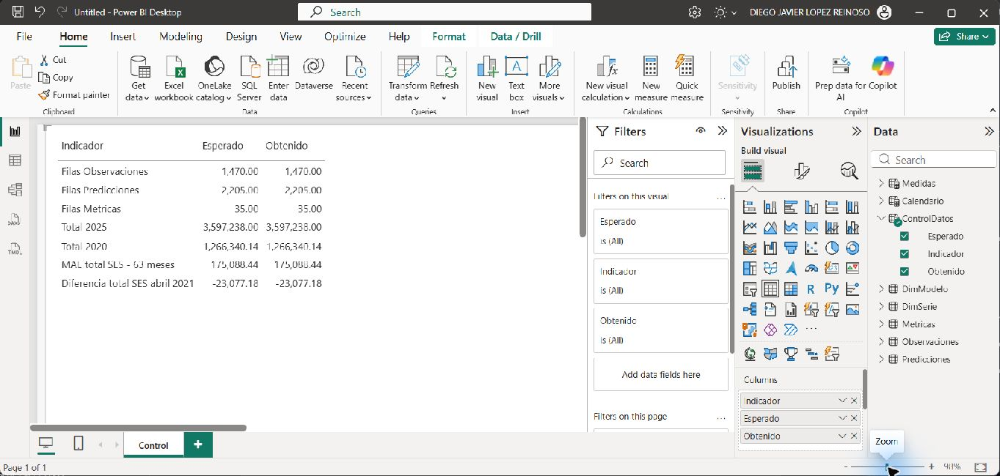
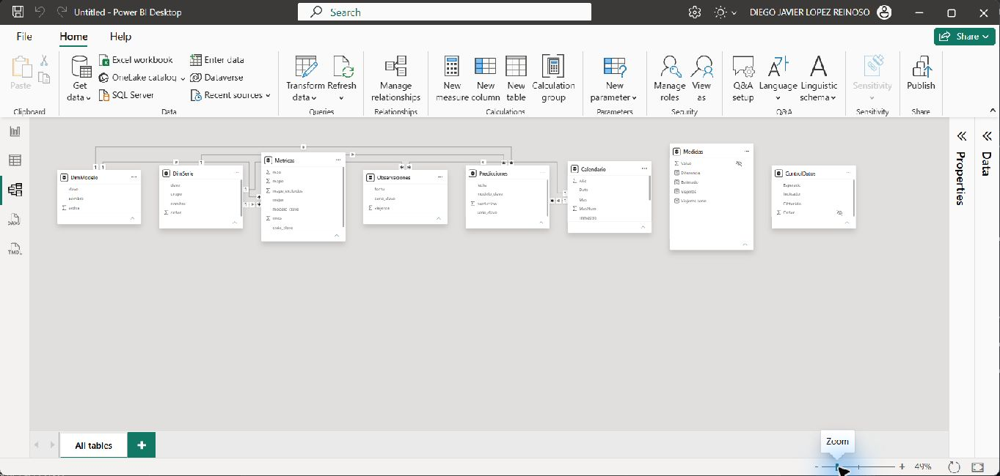
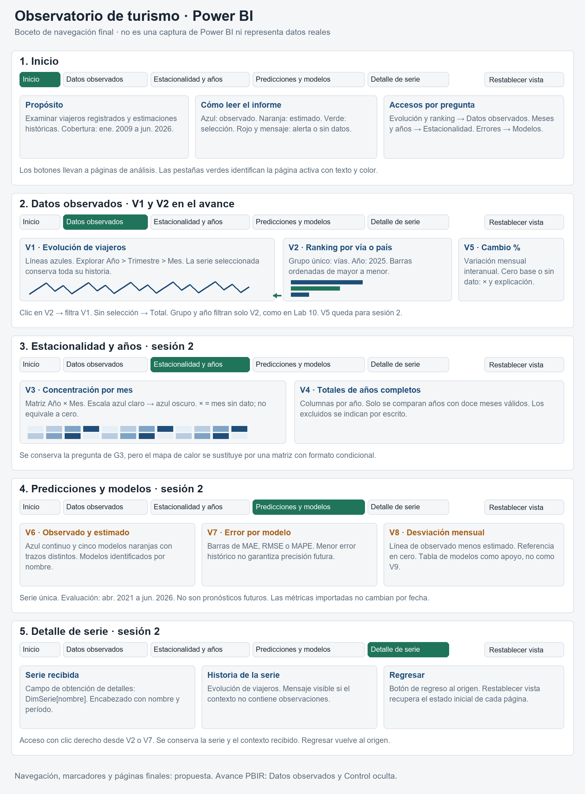
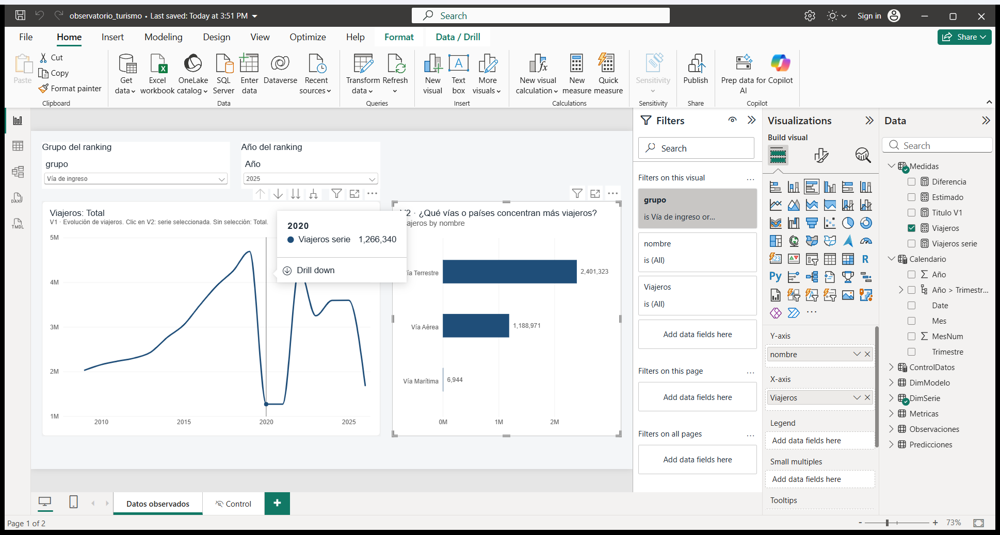
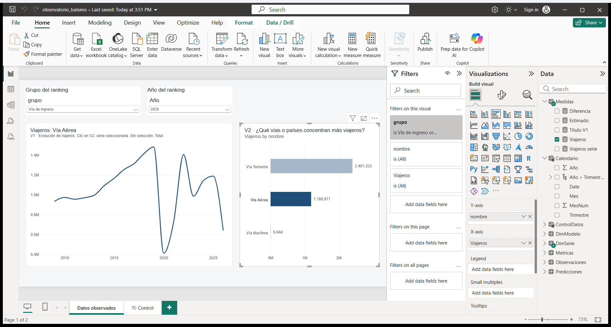

<style>
@page { size: letter; margin: 1.5cm 1.6cm; }
body { max-width: none; margin: 0; padding: 0; font-family: Arial, Helvetica, sans-serif; font-size: 10pt; line-height: 1.3; }
h1 { font-size: 18pt; margin: 0 0 .2em; color: #1F4E79; }
h2 { font-size: 14pt; margin: 1em 0 .3em; padding-bottom: 2px; border-bottom: 1.5px solid #1F4E79; color: #1F4E79; }
h3 { font-size: 11.5pt; margin: .8em 0 .25em; }
h4 { font-size: 10.5pt; margin: .6em 0 .2em; }
p, ul, ol { margin: .3em 0; }
li { margin: .1em 0; }
table { display: table; border-collapse: collapse; width: 100%; margin: .4em 0; font-size: 8.5pt; }
th, td { border: 1px solid #5B6B7A; padding: 2px 5px; vertical-align: top; }
th { background: #E7EFF6; text-align: left; }
pre { margin: .4em 0; padding: 5px 7px; background: #F4F6F8; border: 1px solid #DDE3E9; font-size: 7.5pt; }
pre, pre code { white-space: pre-wrap; overflow-wrap: anywhere; }
figure { margin: .4em 0; text-align: center; }
img { max-width: 100%; max-height: 10cm; }
figcaption { font-size: 8.5pt; color: #5B6B7A; }
</style>

# Lab 12 · Observatorio de turismo en Power BI — Avance

**Curso:** CC3066/CC3084 Data Science, UVG. **Equipo:** Diego, Esteban, Hugo, Ernesto. **Fecha:** 5 de noviembre de 2026. **Rama:** `lab12`. **Archivo:** `powerbi/observatorio_turismo.pbix` (v0.2).

## Importación y modelo de datos en Power BI

**Responsable:** Diego. **Versión del informe:** v0.1. **Fecha:** 5 de noviembre de 2026.

### 1. Alcance y estado

Esta entrega cubre A5 del avance y los apartados 4.4 y 4.5 del documento de diseño. Se importaron las series y resultados existentes, sin entrenar modelos ni modificar `insumos/` o `app/`. Las visualizaciones V5–V8 corresponden a la segunda sesión; V1/V2 y el diseño de navegación corresponden a Hugo.

El modelo fue construido y consultado en Power BI Desktop. El usuario guardó el archivo el 5 de noviembre a las 15:22. Se reabrió desde el repositorio en una instancia nueva, iniciada a las 15:23:36; las consultas de control devolvieron los mismos resultados y las siete relaciones persistieron. La estructura ZIP del archivo pasó la comprobación de integridad y contiene el modelo, la página Control y su visual de tabla.

### 2. Entorno y reproducción

- Windows; Power BI Desktop **2.159.1231.0 64-bit (October 2026)**, verificado en «About».
- Rama `lab12`, actualizada antes de iniciar.
- Modo de almacenamiento Import. Fecha y hora automáticas desactivadas para el archivo actual.
- Archivo previsto: `powerbi/observatorio_turismo.pbix`.
- Comparación histórica: rama `lab10`; `lab11` cambió G6/G7 y retiró G8.

Abrir el `.pbix` en Power BI Desktop. Para cambiar de equipo: «Transform data > Edit parameters», cambiar `RutaInsumos` por la carpeta absoluta `insumos` terminada en `\`, aplicar los cambios y ejecutar «Refresh». Mantener las subcarpetas `series` y `resultados/predicciones`. Las fórmulas M contienen explícitamente `en-US`, independientemente del idioma de Windows.

#### Parámetro `RutaInsumos`

Tipo Texto, obligatorio. Ruta utilizada:

```text
C:\Users\djlop\OneDrive\DIEGO\UVG\2026\segundo semestre\COMPARTIDOS\CC3084-DATA-SCIENCE\insumos\
```

### 3. Fuentes y preparación (4.4)

| Tabla | Fuente | Grano | Filas verificadas |
|---|---|---|---:|
| Observaciones | `insumos/series/serie_<clave>.csv` | Serie y mes | 1.470 |
| Predicciones | `insumos/resultados/predicciones/<serie>_<modelo>.csv` | Serie, modelo y mes | 2.205 |
| Metricas | `insumos/resultados/metricas_modelos.csv` | Serie y modelo, período completo | 35 |

Observaciones cubre enero de 2009 a junio de 2026; predicciones, abril de 2021 a junio de 2026. Los hechos mensuales se relacionan con el primer día del mes. Los archivos se leen con UTF-8 y delimitador coma. Fechas como fecha; valores como número decimal; `mape_excluidos` como entero y `mejor` como lógico. No se redondean, imputan ni agregan las filas durante la importación.

#### Observaciones — Power Query

```m
let
    Archivos = Table.SelectRows(Folder.Files(RutaInsumos & "series"), each [Extension] = ".csv"),
    ConClave = Table.AddColumn(Archivos, "serie_clave", each Text.BetweenDelimiters([Name], "serie_", ".csv"), type text),
    ConDatos = Table.AddColumn(ConClave, "Datos", each Table.PromoteHeaders(Csv.Document([Content], [Delimiter = ",", Encoding = 65001]))),
    Expandido = Table.ExpandTableColumn(Table.SelectColumns(ConDatos, {"serie_clave", "Datos"}), "Datos", {"fecha", "viajeros"}),
    Tipos = Table.TransformColumnTypes(Expandido, {{"fecha", type date}, {"viajeros", type number}}, "en-US")
in
    Tipos
```

#### Predicciones — Power Query

```m
let
    Modelos = {"sarima", "holt_winters", "ses", "seasonal_naive", "prophet"},
    Archivos = Table.SelectRows(Folder.Files(RutaInsumos & "resultados\predicciones"), each [Extension] = ".csv"),
    ConModelo = Table.AddColumn(Archivos, "modelo_clave", each List.First(List.Select(Modelos, (m) => Text.EndsWith([Name], "_" & m & ".csv"))), type text),
    ConSerie = Table.AddColumn(ConModelo, "serie_clave", each Text.Start([Name], Text.Length([Name]) - Text.Length([modelo_clave]) - 5), type text),
    ConDatos = Table.AddColumn(ConSerie, "Datos", each Table.PromoteHeaders(Csv.Document([Content], [Delimiter = ",", Encoding = 65001]))),
    Expandido = Table.ExpandTableColumn(Table.SelectColumns(ConDatos, {"serie_clave", "modelo_clave", "Datos"}), "Datos", {"fecha", "prediccion"}),
    Tipos = Table.TransformColumnTypes(Expandido, {{"fecha", type date}, {"prediccion", type number}}, "en-US")
in
    Tipos
```

#### Metricas — Power Query

```m
let
    Origen = Csv.Document(File.Contents(RutaInsumos & "resultados\metricas_modelos.csv"), [Delimiter = ",", Encoding = 65001, QuoteStyle = QuoteStyle.Csv]),
    Columnas = Table.SelectColumns(Table.PromoteHeaders(Origen), {"serie", "modelo", "mae", "rmse", "mape", "mape_excluidos", "mejor"}),
    Renombradas = Table.RenameColumns(Columnas, {{"serie", "serie_clave"}, {"modelo", "modelo_clave"}}),
    Tipos = Table.TransformColumnTypes(Renombradas, {{"mae", type number}, {"rmse", type number}, {"mape", type number}, {"mape_excluidos", Int64.Type}, {"mejor", type logical}}, "en-US")
in
    Tipos
```

Los nombres de archivo conservan las claves originales. En Predicciones se reconoce el sufijo de uno de los cinco modelos, evitando dividir arbitrariamente por guiones bajos. Metricas conserva MAE, RMSE, MAPE, exclusiones y el indicador de mejor modelo; `order`, AIC y BIC no se incorporan ni se completan.

#### Dimensiones

Se crearon como tablas constantes de Power Query, equivalentes a «Enter data». El usuario confirmó numerar según la secuencia del contexto.

**DimSerie**

```m
#table(type table [clave = text, nombre = text, grupo = text, orden = Int64.Type], {{"total", "Total", "Total", 1}, {"via_aerea", "Vía Aérea", "Vía de ingreso", 2}, {"via_terrestre", "Vía Terrestre", "Vía de ingreso", 3}, {"via_maritima", "Vía Marítima", "Vía de ingreso", 4}, {"pais_el_salvador", "El Salvador", "País de residencia", 5}, {"pais_estados_unidos", "Estados Unidos", "País de residencia", 6}, {"pais_honduras", "Honduras", "País de residencia", 7}})
```

**DimModelo**

```m
#table(type table [clave = text, nombre = text, orden = Int64.Type], {{"sarima", "SARIMA", 1}, {"holt_winters", "Holt-Winters", 2}, {"ses", "Suavizamiento exponencial simple (SES)", 3}, {"seasonal_naive", "Referencia estacional (Seasonal Naive)", 4}, {"prophet", "Prophet", 5}})
```

`nombre` se ordena por `orden` en ambas dimensiones. Los grupos de DimSerie son Total, Vía de ingreso y País de residencia. Las tres vías suman el total; los tres países no representan todos los mercados.

#### Calendario

```dax
Calendario =
ADDCOLUMNS (
    CALENDAR ( DATE ( 2009, 1, 1 ), DATE ( 2026, 12, 31 ) ),
    "Año", YEAR ( [Date] ),
    "Trimestre", "T" & QUARTER ( [Date] ),
    "MesNum", MONTH ( [Date] ),
    "Mes", FORMAT ( [Date], "mmm", "es-ES" )
)
```

Tabla de fechas marcada con `Date`; calendario diario con años completos, del 01/01/2009 al 31/12/2026. `Mes` se ordena por `MesNum`; jerarquía Año > Trimestre > Mes. La cobertura del calendario no significa que existan observaciones en todos sus días o meses.

### 4. Relaciones y prevención de duplicaciones (4.5)

| Dimensión, lado uno | Tabla, lado varios |
|---|---|
| DimSerie[clave] | Observaciones[serie_clave] |
| DimSerie[clave] | Predicciones[serie_clave] |
| DimSerie[clave] | Metricas[serie_clave] |
| DimModelo[clave] | Predicciones[modelo_clave] |
| DimModelo[clave] | Metricas[modelo_clave] |
| Calendario[Date] | Observaciones[fecha] |
| Calendario[Date] | Predicciones[fecha] |

Las siete relaciones están activas, con filtro unidireccional de la dimensión al hecho. No existen relaciones entre hechos. Metricas no tiene relación temporal: sus valores corresponden a los 63 meses completos, no al período escogido en Calendario.

Se verificaron cero duplicados en las claves compuestas de los tres hechos, siete series y cinco modelos. Las consultas de claves sin correspondencia devolvieron conjuntos vacíos (DAX COUNTROWS devuelve BLANK para estos conjuntos). No se unen observaciones con las cinco predicciones en una tabla plana, por lo que no se multiplica el observado por el número de modelos.

### 5. Medidas DAX y finalidad

Las cuatro medidas están en una tabla independiente `Medidas`. Se intentó ubicarlas en Observaciones, pero Power BI rechazó `Viajeros` por coincidir, sin distinguir mayúsculas, con la columna `viajeros`. Las instrucciones permiten una tabla de medidas; se mantuvieron los nombres y fórmulas originales. La columna auxiliar de Medidas está oculta y esta tabla no tiene relaciones.

```dax
Viajeros = SUM ( Observaciones[viajeros] )

Viajeros serie =
IF (
    HASONEVALUE ( DimSerie[clave] ),
    [Viajeros],
    CALCULATE ( [Viajeros], REMOVEFILTERS ( DimSerie ), DimSerie[clave] = "total" )
)

Estimado =
IF (
    HASONEVALUE ( DimSerie[clave] ) && HASONEVALUE ( DimModelo[clave] ),
    SUM ( Predicciones[prediccion] )
)

Diferencia =
SUMX (
    VALUES ( Calendario[Date] ),
    VAR o = [Viajeros]
    VAR p = [Estimado]
    RETURN IF ( NOT ISBLANK ( o ) && NOT ISBLANK ( p ), o - p )
)
```

- **Viajeros:** suma observaciones en el contexto seleccionado; requiere controlar la serie para no sumar grupos incompatibles.
- **Viajeros serie:** usa la única serie seleccionada; con ninguna o varias series devuelve Total. La selección múltiple no se interpreta como suma de las series elegidas.
- **Estimado:** devuelve valores únicamente con una serie y un modelo; vacío en selecciones ambiguas.
- **Diferencia:** observado menos estimado, sumado solo en fechas con ambos valores; no convierte ausencia en cero.

### 6. Validación en Power BI

Las consultas DAX se ejecutaron contra el modelo abierto mediante el MCP local. Sus resultados, consultas y huellas de los CSV están en [01_diego_validacion.json](01_diego_validacion.json).

| Control | Esperado | Obtenido en Power BI |
|---|---:|---:|
| Filas Observaciones | 1.470 | 1.470 |
| Filas Predicciones | 2.205 | 2.205 |
| Filas Metricas | 35 | 35 |
| Total 2025 | 3.597.238 | 3.597.237,9999999995 |
| Total 2020, redondeado | 1.266.340 | 1.266.340,1437961974 |
| MAE total / SES | 175.088,44 | 175.088,43650293106 |
| Diferencia total / SES / abril 2021 | −23.077,18 | −23.077,1845384029 |
| Viajeros serie sin selección, año 2025 | Total 2025 | 3.597.237,9999999995 |
| Estimado sin selección / múltiples modelos | Vacío | BLANK |
| Diferencia total / SES, año 2010 | Vacío | BLANK |
| Duplicados por clave en cada hecho | 0 | 0 / 0 / 0 |

Las diferencias de presentación provienen del redondeo y de la representación binaria de números decimales. El total de 2020 ya tiene fracciones en los CSV; no se reemplazó por el entero del contexto.

Se consultaron también los siete totales por serie de 2025, los cuatro trimestres de 2020 y la variación interanual de enero de 2025; los resultados completos se conservan en la evidencia JSON.

#### Página Control

Contiene una tabla con Indicador, Esperado y Obtenido, alimentada por `ControlDatos`, tabla calculada desconectada. Sus siete controles se recalculan al actualizar el modelo, no al mover segmentadores. Es un diagnóstico técnico, no cuenta como visualización analítica del laboratorio. Hugo deberá ocultar esta página en la versión final.





### 7. Limitaciones y continuación

- Las predicciones se refieren a meses históricos, sin intervalos de confianza; los CSV no documentan una separación independiente entre entrenamiento y evaluación.
- Un menor error histórico no garantiza precisión futura.
- Las métricas importadas resumen abril de 2021 a junio de 2026. No deben presentarse como métricas recalculadas al filtrar fechas; la equivalencia con el G7 dinámico de Lab 10 queda para la especificación de modelos de la segunda sesión.
- El indicador `mejor` proviene del archivo original; no se recalcula para nuevas selecciones.
- Años incompletos, por ejemplo 2026, no deben compararse como si tuvieran doce meses.
- Guardado y reapertura verificados. La actualización completa del modelo se ejecutó antes del guardado; los conteos y valores persistidos se verificaron de nuevo en la instancia reabierta.

## Diseño, navegación y visualizaciones enlazadas

**Responsable:** Hugo. **Fecha:** 5 de noviembre de 2026. **Alcance:** avance A2, A4 y A6.

**Estado:** v0.2 local, abierta y guardada con Power BI Desktop. La publicación remota y el envío a Esteban no se han realizado.

### 1. Alcance y archivos

La propuesta conserva las preguntas, fuentes y colores del Lab 10. La consulta histórica se realizó contra la rama `lab10`, no contra `lab11`. No se modificaron `insumos/` ni `app/`, ni se entrenaron modelos.

| Entregable | Archivo |
|---|---|
| Tema importable | `powerbi/tema_observatorio.json` |
| Boceto de las cinco páginas | `docs/figuras/lab12_hugo_boceto.png` |
| Informe con página Datos observados | `powerbi/observatorio_turismo.pbix` |
| Generador de la página PBIR | `docs/scripts/build_lab12_report.py` |
| Generador del boceto | `docs/scripts/draw_lab12_wireframe.py` |
| Pruebas automatizadas | `tests/test_lab12_design.py` |
| Capturas reales | `docs/figuras/lab12_hugo_v1_v2_inicial.png` y `docs/figuras/lab12_hugo_v1_v2_seleccion.png` |

La edición del informe fue autorizada por el usuario tras confirmar el traspaso de Diego a Hugo. Se conservan los datos importados, las relaciones y las cuatro medidas base. Se agregó únicamente la medida de presentación `Titulo V1` desde Power BI Desktop. La copia anterior permanece en `TEMP/observatorio_turismo_antes_hugo.pbix`, fuera del control de versiones.

### 2. Paleta y justificación · A2

| Uso | Color | Justificación |
|---|---|---|
| Datos observados | Azul `#1F4E79` | Color frío y estable para datos registrados. Mantiene el significado del Lab 10. |
| Estimaciones | Naranja `#A65E16` | Contrasta con el azul y separa las estimaciones de las observaciones. |
| Selección activa | Verde `#20745A` | Se reserva para selección y página activa, no para otra serie. |
| Alertas y ausencia de datos | Rojo `#B3261E` | Se acompaña de una advertencia escrita, nunca aparece como otra serie. |
| Fondo | `#F4F6F8` | Separa el lienzo de las tarjetas sin competir con los datos. |
| Tarjetas | Blanco `#FFFFFF` | Mantiene una superficie uniforme para gráficas y texto. |
| Texto principal | `#1B2733` | Facilita la lectura de títulos y cantidades. |
| Texto secundario | `#5B6B7A` | Diferencia las ayudas sin perder contraste. |
| Cuadrícula | `#DDE3E9` | Referencia tenue que no sustituye los ejes ni sus etiquetas. |
| Escala de estacionalidad | `#E7EFF6` → `#1F4E79` | Escala secuencial equivalente a G3 para valores de menor a mayor magnitud. |

El tema contiene los cinco colores de modelos, pero una paleta automática no garantiza su correspondencia con cada modelo. Al construir V6 se asignarán explícitamente los siguientes nombres, colores y trazos:

| Modelo | Color | Trazo del Lab 10 |
|---|---|---|
| SARIMA | `#A65E16` | Guiones |
| Holt-Winters | `#6B3A0C` | Puntos |
| SES | `#C46A12` | Guion y punto |
| Seasonal Naive | `#8A4B12` | Guion largo |
| Prophet | `#D07A1E` | Guion largo y punto |

Se conserva **Arial** para evitar que una tipografía diferente afecte la comparación con Dash. Los títulos tienen al menos 14 pt; los encabezados, 12 pt; las etiquetas y ayudas, 10 pt. Las tarjetas de indicadores utilizan 28 pt.

Las pruebas comprueban una relación de contraste de al menos **4,5:1** para los colores de texto del tema tanto sobre blanco como sobre el fondo gris. Los tonos naranjas de los modelos no se emplean como texto pequeño. La cuadrícula es decorativa y no se interpreta como texto.

El significado no depende únicamente del color: los modelos tendrán nombres y trazos diferentes; la página activa tendrá una etiqueta; la ausencia de datos se indicará con `×` y un mensaje. El verde de selección deberá acompañarse de un nombre visible y del cambio de contenido en V1. El resaltado verde del boceto es una especificación visual, no una prueba del estilo de selección nativo de Power BI.

### 3. Boceto y navegación · A4



El dibujo es un boceto con marcas ilustrativas, no una captura de Power BI ni una representación de valores reales.

| Página | Contenido | Navegación y contexto |
|---|---|---|
| Inicio | Propósito, cobertura, leyenda y accesos por pregunta | Botones a cada página analítica. |
| Datos observados | V1, V2 y posteriormente V5 | Grupo y año filtran el ranking. V2 filtra V1. |
| Estacionalidad y años | V3 y V4 | Selección de serie y años. V4 excluye años incompletos. |
| Predicciones y modelos | V6, V7, V8 y tabla de apoyo | Serie única. Las métricas importadas representan los 63 meses completos. |
| Detalle de serie | Historia y contexto de una serie | Obtención de detalles desde V2 o V7 con `DimSerie[nombre]` y botón de regreso. |

En la sesión 2 todas las páginas tendrán navegación con página activa identificada, ayuda breve y «Restablecer vista». Cada marcador de restablecimiento guardará el estado inicial de su página, sus segmentadores y sus selecciones. El regreso desde Detalle de serie volverá al origen; no reemplazará el botón de restablecimiento.

#### Equivalencia con Lab 10

- Se conservan las ocho preguntas G1–G8, las siete series, los cinco modelos, los colores y el clic ranking → serie temporal.
- Se sustituye la página única con casillas de visibilidad por páginas temáticas. La navegación final todavía pertenece a la sesión 2.
- V3 sustituirá el mapa de calor por una matriz año × mes con formato condicional. El cambio afecta la presentación, no la pregunta.
- Las tarjetas, segmentadores, botones, ayudas y tabla de modelos no cuentan como visualizaciones analíticas.
- No se comparan años incompletos con años completos. Los tres países no representan todos los mercados y nunca se suman con las vías o el total.

En el avance solo se incorpora «Datos observados». La página técnica «Control» de Diego se conserva y se oculta en modo de lectura. Las otras páginas del boceto no se presentan como implementadas.

### 4. V1, V2 e interacciones · A6

| Aspecto | V1 · Evolución | V2 · Ranking |
|---|---|---|
| Pregunta | ¿Cómo ha evolucionado el ingreso de viajeros y en qué épocas sube o baja? | ¿Qué vías o países concentran más viajeros? |
| Tipo | Gráfica de líneas | Barras horizontales |
| Eje | Calendario: Año > Trimestre > Mes | `DimSerie[nombre]` |
| Valor | `[Viajeros serie]`, en Medidas | `[Viajeros]`, en Medidas |
| Orden | Tiempo ascendente | Viajeros descendente |
| Color base | Azul observado | Azul observado |
| Filtro específico | Una serie seleccionada o Total por defecto | Grupo Vía de ingreso o País de residencia; excluye Total |

La definición PBIR configura **V2 → V1 como `DataFilter`**, equivalente a elegir «Filtrar» en «Editar interacciones». No se utiliza un segmentador compartido como sustituto de esta relación.

Los segmentadores de grupo y año afectan **solo a V2**, como en Lab 10. El estado inicial es «Vía de ingreso», año 2025. Un clic en «Vía Aérea» debe mostrar su historia completa en V1, sin limitarla a 2025. Al retirar la selección, `[Viajeros serie]` debe volver a Total. Con varias series seleccionadas la medida devuelve Total, nunca una suma de vías y países.

Las interacciones inversas y las interacciones entre segmentadores están desactivadas. La selección de una barra no debe reducir las opciones del grupo o del año.

La exploración temporal se prepara con los campos Año, Trimestre y Mes en el eje, inicialmente en Año. No se utiliza la jerarquía automática de fechas. La operación de exploración se verifica en Desktop.

#### Título de la serie

La medida `Titulo V1` se creó desde Power BI Desktop y se vinculó al título de V1 mediante una expresión de formato condicional en PBIR:

```dax
Titulo V1 =
"Viajeros: "
    & IF (
        HASONEVALUE ( DimSerie[nombre] ),
        SELECTEDVALUE ( DimSerie[nombre] ),
        "Total"
    )
```

El título debe alternar entre «Viajeros: Total» y «Viajeros: Vía Aérea» durante la prueba de selección. La pregunta de gestión se conserva en esta especificación y en el texto alternativo de la gráfica.

### 5. Protocolo de comprobación en Power BI

1. Abrir el `.pbix` con Power BI Desktop 2.159.1231.0 o una versión compatible. Confirmar que no existen avisos de archivo inválido ni errores de consulta.
2. Confirmar Arial, fondo gris, tarjetas blancas y líneas azules. El tema también puede importarse desde «Vista > Temas > Examinar temas».
3. Seleccionar «Datos observados» y verificar grupo «Vía de ingreso», año 2025.
4. Confirmar el ranking: Terrestre **2.401.323**, Aérea **1.188.971** y Marítima **6.944** viajeros. La suma es **3.597.238**.
5. Confirmar V1 en Total y explorar Año > Trimestre > Mes. El total de 2025 debe redondearse a **3.597.238**.
6. Hacer clic en «Vía Aérea». V1 debe cambiar a esa serie, conservar toda su cobertura y mostrar **1.188.971** al consultar 2025. Guardar la captura con selección.
7. Quitar la selección y confirmar el regreso a Total. Guardar la captura inicial.
8. Cambiar el grupo a «País de residencia». Confirmar El Salvador **1.738.267**, Estados Unidos **679.282** y Honduras **298.542** en 2025. No deben aparecer vías ni Total en ese ranking.
9. Revisar «Formato > Editar interacciones»: V2 filtra V1; grupo y año no filtran V1. Confirmar el título dinámico tras aplicar la medida anterior.
10. Restituir el grupo Vía de ingreso, año 2025 y ninguna barra seleccionada. Guardar, cerrar y reabrir el informe para confirmar la persistencia.

Capturas requeridas:

- `docs/figuras/lab12_hugo_v1_v2_inicial.png`
- `docs/figuras/lab12_hugo_v1_v2_seleccion.png`

Solo se aceptan capturas reales de Power BI como evidencia de A6. El boceto y las pruebas de estructura no reemplazan la prueba gráfica → gráfica.

#### Comprobación realizada

La prueba nativa se ejecutó con Power BI Desktop **2.159.1231.0**. El ranking mostró 2.401.323, 1.188.971 y 6.944 viajeros para las tres vías en 2025. La selección de Vía Aérea cambió el título a «Viajeros: Vía Aérea» y el primer punto anual de V1 a **935.379** viajeros de 2009. Al retirar la selección reaparecieron «Viajeros: Total» y **2.028.776** viajeros de 2009. La permanencia de 2009 confirma que el segmentador 2025 no limita la historia de V1.

Las cantidades de las siete series en 2025 se contrastaron también con los CSV originales. Las capturas siguientes proceden de la ventana nativa de Power BI, no de una recreación. La selección nativa mantiene la barra elegida y atenúa las demás; el título identifica la serie sin depender del color.

Después de guardar y cerrar Desktop, una instancia nueva conservó el tema, los tres valores del ranking, «Viajeros: Total» y la interacción con Vía Aérea. Las **12 pruebas automatizadas** del diseño, el tema, el boceto y la escritura segura del contenedor pasaron. La validación de las cinco definiciones PBIR generadas también pasó contra sus esquemas oficiales. La evidencia y las huellas de los archivos se conservan en [02_hugo_validacion.json](02_hugo_validacion.json).





El registro de tiempo de `TEMP/CONTEXTO.md` recoge **30 minutos reales de Power BI** y **60 minutos estimados de Dash Lab 10**, ambos declarados por Hugo. La estimación de Dash se basa en su recuerdo, no en una medición de commits.

### 6. Reproducción y precauciones

Desde la raíz del repositorio, con el entorno Python académico existente:

```powershell
..\.venv\Scripts\python.exe docs/scripts/draw_lab12_wireframe.py
..\.venv\Scripts\python.exe -m pytest tests/test_lab12_design.py tests/test_wireframe.py tests/test_theme.py -q
```

El generador `build_lab12_report.py` se ejecuta únicamente con Desktop cerrado y sobre una copia controlada del informe que ya contenga `Medidas[Titulo V1]`. Reemplaza la definición de Datos observados y la referencia al tema; no debe ejecutarse después de ajustes manuales sin respaldarlos primero. Conserva el modelo binario de entrada y la página Control. El contenedor se escribe primero en un archivo temporal y solo reemplaza al original después de comprobar su integridad.

`RutaInsumos` continúa con el valor del equipo de Diego porque forma parte del modelo preservado. Antes de actualizar los datos en otro equipo se deberá cambiar ese parámetro a la carpeta local `insumos`. No es necesario refrescar para comprobar los datos ya importados.

Los esquemas oficiales PBIR se usan para comprobar la estructura de la página y las gráficas. Esa comprobación no certifica la renderización, los nombres del modelo ni el comportamiento de la aplicación. El control nativo de apertura prevalece sobre una validación de JSON.

No se refrescaron los datos, no se ejecutó la suite completa de modelos y no se certificaron todavía las páginas de la sesión 2. La exploración Año > Trimestre > Mes se configuró y se verificó en la estructura del eje; no se realizó una prueba exhaustiva de sus botones.

### 7. Pendientes de la sesión 2

V3, V4, navegación final, marcadores, restablecimiento, obtención de detalles y mensajes de ausencia de datos. V5–V8 corresponden a Diego con la especificación de Esteban. La entrega remota y el envío a Esteban requieren actuación expresa del equipo; no se ejecuta `git push`.

### Referencias

- [Temas de informes de Power BI](https://learn.microsoft.com/power-bi/create-reports/desktop-report-themes)
- [Interacciones entre visualizaciones](https://learn.microsoft.com/power-bi/create-reports/service-reports-visual-interactions)
- [Formato PBIR](https://learn.microsoft.com/power-bi/developer/projects/projects-report)
- [Esquema de página PBIR](https://developer.microsoft.com/json-schemas/fabric/item/report/definition/page/2.1.0/schema.json)
- [Esquema de visual PBIR](https://developer.microsoft.com/json-schemas/fabric/item/report/definition/visualContainer/2.7.0/schema.json)

## Preguntas de gestión, planificación y protocolo de comparación

**Responsable:** Esteban. **Fecha:** 5 de noviembre de 2026. **Alcance:** avance A1, A3 y A7.

**Punto de partida:** `b47e73d` en `lab12`, con la importación de Diego (v0.1) y el diseño de Hugo (v0.2). La versión de referencia del Laboratorio 10 es la rama `lab10`, tablero en Dash. No se modificaron `insumos/`, `app/` ni el `.pbix`; la edición del informe sigue a cargo de Hugo.

### 1. Preguntas de gestión, público y alcance · A1

#### Público

Directivos y tomadores de decisiones del sector turístico que no necesariamente tienen formación en estadística. El informe debe leerse sin conocer los procedimientos de los modelos; los términos técnicos (MAE, RMSE, MAPE, estimación) se explican en la página donde aparecen.

#### Preguntas

Se conservan las ocho preguntas del Laboratorio 10, con el mismo texto. Cada visualización de Power BI responde a la pregunta de su gráfica equivalente.

| Lab 10 | Power BI | Pregunta de gestión | Página prevista |
|---|---|---|---|
| G1 | V1 | ¿Cómo ha evolucionado el ingreso de viajeros? | Datos observados |
| G2 | V2 | ¿Qué vías o países concentran más viajeros? | Datos observados |
| G3 | V3 | ¿En qué meses se concentra el ingreso de viajeros? | Estacionalidad y años |
| G4 | V4 | ¿Cómo cambia el total de viajeros entre años completos? | Estacionalidad y años |
| G5 | V5 | ¿Cuánto cambió cada mes frente al mismo mes del año anterior? | Datos observados |
| G6 | V6 | ¿Qué estimaron los modelos frente a lo que se registró? | Predicciones y modelos |
| G7 | V7 | ¿Qué modelo se equivoca menos para esta serie? | Predicciones y modelos |
| G8 | V8 | ¿En qué meses se alejó el modelo de lo observado? | Predicciones y modelos |

Se compara contra `lab10` y no contra `lab11`, porque `lab11` cambió G6 y G7 y retiró G8.

#### Alcance

Igual al del Laboratorio 10:

- **Datos observados:** siete series mensuales de viajeros (Total, tres vías de ingreso y tres países de residencia), de enero de 2009 a junio de 2026.
- **Estimaciones:** resultados existentes del Laboratorio 1 de cinco modelos (SARIMA, Holt-Winters, SES, Seasonal Naive y Prophet), de abril de 2021 a junio de 2026, 63 meses por serie y modelo. Se cumplen los tres modelos mínimos; SARIMA, Holt-Winters y SES son la selección inicial, como en G6.
- **Métricas:** MAE, RMSE y MAPE de `metricas_modelos.csv`, calculadas sobre los 63 meses completos.
- No se entrenan modelos nuevos ni se recalculan predicciones.

#### Decisiones que puede apoyar

- Identificar las vías y los mercados que concentran más viajeros en un año, para priorizar recursos de atención.
- Localizar las temporadas altas y bajas de cada serie para planificar personal y servicios.
- Revisar si un año completo o un mes concreto creció o cayó frente al anterior.
- Saber qué estimación histórica se acercó más a lo registrado en cada serie, para decidir con qué cautela consultarla.

#### Fuera de alcance

- Explicar las causas de los cambios. Los datos describen volúmenes registrados, no sus motivos.
- Pronosticar meses futuros. Las estimaciones corresponden a meses ya registrados y no tienen intervalos de confianza.
- Representar todos los mercados de origen. Los tres países no suman el total y nunca se mezclan con las vías.
- Comparar años incompletos, como 2026, con años completos.
- Garantizar la precisión futura de un modelo. Un error histórico menor no la asegura, y los CSV no documentan una separación independiente entre entrenamiento y evaluación.

### 2. Planificación de tareas y responsables · A3

Fechas de terminación propuestas. Las celdas «por confirmar» se acuerdan en el grupo; no se registran fechas de realización que no hayan ocurrido.

| Tarea | Responsable | Terminación | Estado al 5-nov 16:30 |
|---|---|---|---|
| Importación, relaciones y medidas base (A5, 4.4, 4.5) | Diego | 5-nov | Hecho, `f43b181`, `c147d9e` |
| Paleta, tema, boceto y navegación (A2, A4, 4.2) | Hugo | 5-nov | Hecho, `e668fd8`, `b47e73d` |
| V1 y V2 enlazadas (A6) | Hugo | 5-nov | Hecho, `f4eb7b0` |
| Preguntas, alcance, planificación y protocolo (A1, A3, A7) | Esteban | 5-nov | Este documento |
| Entrega del avance en Canvas | Ernesto | 5-nov 17:20 | Pendiente |
| Especificación de V5–V8 y equivalencia con G5–G8 | Esteban | 6-nov | Pendiente |
| V5–V8 en Power BI | Diego | 7-nov | Pendiente |
| V3, V4, navegación final, marcadores, restablecimiento, drillthrough y mensajes sin datos | Hugo | 7-nov | Pendiente |
| Ejecución de las tres pruebas en ambas versiones y verificación de indicadores (5.3–5.5) | Esteban | 7-nov | Pendiente |
| Costos, licencias y condiciones de distribución con fuentes oficiales (5.2) | Por confirmar | 7-nov | Pendiente |
| Matriz de comparación y recomendaciones (5.1, 5.6) | Esteban | 8-nov | Pendiente |
| README de Power BI, documento de diseño y PDF final | Por confirmar | 8-nov 20:00 | Pendiente |
| Revisión cruzada y entrega final | Todo el equipo | 8-nov 23:59 | Pendiente |

Hugo conserva la edición del `.pbix` hasta terminar la sesión 2. Quien edite después recibe el archivo por traspaso explícito, para no sobrescribir trabajo.

#### Registro de tiempo efectivo (4.6)

Cada integrante anota sus minutos reales por herramienta al terminar cada tarea. Lo medido se distingue de lo estimado.

| Integrante | Power BI (Lab 12) | Dash (Lab 10) | Tipo |
|---|---:|---:|---|
| Hugo | 30 min | 60 min | Power BI medido; Dash estimado por recuerdo |
| Diego | Por registrar | Por registrar | — |
| Esteban | Por registrar | Por registrar | — |

### 3. Criterios de comparación y protocolo de las tres pruebas · A7

#### Criterios de la matriz (5.1)

En la entrega final, la matriz tendrá las columnas criterio, evidencia en Dash, evidencia en Power BI e implicación para la tarea. Para el avance se fija qué evidencia se recoge en cada criterio.

| Criterio | Evidencia a recoger en ambas versiones |
|---|---|
| Facilidad de aprendizaje | Conocimientos previos necesarios y dificultades anotadas por cada integrante. |
| Tiempo de desarrollo | Registro de tiempo de la sección 2, por visualización comparable. |
| Preparación y actualización de datos | Pasos para cargar los CSV y para refrescarlos tras un cambio de ruta o de datos: `app/data.py` frente a Power Query y `RutaInsumos`. |
| Integración de resultados de modelos | Cómo se relacionan predicciones y métricas sin duplicar filas: `model_results.align_models` frente a las relaciones y medidas DAX. |
| Interacción y navegación | Clics de las tres pruebas; enlace G2 → G1 frente a filtrado cruzado V2 → V1; casillas de gráficas visibles frente a páginas y marcadores. |
| Personalización | Qué se pudo reproducir del Lab 10 y qué se sustituyó, por ejemplo el mapa de calor por una matriz con formato condicional. |
| Rendimiento | Tiempo de carga inicial y de respuesta a un filtro, en el mismo equipo cuando sea posible. |
| Colaboración y control de versiones | Diferencias legibles en Git: código Python frente a `.pbix` binario y definiciones PBIR. |
| Requisitos para compartir o desplegar | Qué necesita quien consulta: Python y servidor frente a Power BI Desktop o el servicio con licencia. |

Para costos y acceso (5.2) se registrarán sistema operativo, licencias, alojamiento y restricciones, con enlace a la documentación oficial y fecha de consulta. El uso local gratuito se separa de las condiciones para publicar y compartir. Un dato de entorno ya conocido: Power BI Desktop solo se ejecuta en Windows, mientras que el tablero de Dash corre en Linux, Windows o macOS desde un navegador.

#### Condiciones comunes (5.4)

- Mismos CSV de `insumos/`, sin refrescar ni modificar.
- Estado inicial de cada versión: recién abierta, sin selecciones previas. En Power BI, grupo «Vía de ingreso» y año 2025, como deja Hugo la página.
- Para cada prueba se registran el resultado obtenido, los clics desde el estado inicial, el tiempo con cronómetro desde el primer clic hasta leer el resultado, y las dificultades.
- Se anotan el equipo, el sistema operativo, la ventana y la experiencia previa de quien ejecuta. Power BI necesita Windows; si se ejecuta en otro equipo o en una máquina virtual, esa diferencia se informa y no se atribuye a la herramienta.
- Una persona ejecuta las tres pruebas en ambas versiones, en orden alterno, para no favorecer a la que se usa en segundo lugar.

#### Prueba 1 · Responder una pregunta de gestión con filtros

**Pregunta:** ¿Qué vía de ingreso concentró más viajeros en 2025 y cuántos registró?

| Paso | Dash (Lab 10) | Power BI |
|---|---|---|
| 1 | En G2, elegir el grupo «Vía de ingreso». | En Datos observados, segmentador de grupo en «Vía de ingreso». |
| 2 | Elegir el año 2025. | Segmentador de año en 2025. |
| 3 | Leer la primera barra y su valor en el cursor. | Leer la primera barra de V2 y su valor. |

**Resultado esperado:** Vía Terrestre, **2.401.323** viajeros, seguida de Vía Aérea con **1.188.971** y Vía Marítima con **6.944**. La suma es **3.597.238**, igual al Total de 2025. Ningún país ni el Total aparecen en el ranking.

#### Prueba 2 · De la vista general al detalle y regreso

**Pregunta:** En la serie Total, ¿qué mes del cuarto trimestre de 2025 registró más viajeros?

| Paso | Dash (Lab 10) | Power BI |
|---|---|---|
| 1 | En G1, serie Total y nivel anual. Leer 2025. | V1 sin selección, en Total y nivel Año. Leer 2025. |
| 2 | Cambiar a nivel trimestral y leer T4 2025. | Bajar a Trimestre desde 2025 y leer T4. |
| 3 | Cambiar a nivel mensual y leer octubre a diciembre de 2025. | Bajar a Mes desde T4 y leer octubre a diciembre. |
| 4 | Volver al nivel anual. | Subir dos niveles hasta Año. |

**Resultado esperado:** 2025 suma **3.597.238**; T4 2025, **997.817**; octubre **277.299**, noviembre **328.431** y diciembre **392.087**. Diciembre es el máximo del trimestre. Al regresar se ven de nuevo los totales anuales.

Hay que vigilar 2026, que solo tiene seis meses. Dash no suma periodos incompletos: omite 2026 en el nivel anual y lo menciona en la nota. La jerarquía de Power BI suma lo que haya y mostraría 2026 con **1.682.636**, que puede leerse como una caída anual. La diferencia se registra en la prueba, y en Power BI se marca 2026 como año parcial o se excluye del nivel Año.

En Dash el detalle se cambia con el selector de nivel de G1; en Power BI, con la jerarquía Año > Trimestre > Mes de V1. Se cuentan los clics de ambos recorridos completos, incluido el regreso.

#### Prueba 3 · Consultar las predicciones y comparar tres modelos

**Pregunta:** Para la serie Total, entre SARIMA, Holt-Winters y SES, ¿qué modelo tiene menor error medio y cuánto?

| Paso | Dash (Lab 10) | Power BI |
|---|---|---|
| 1 | En G6, serie Total con SARIMA, Holt-Winters y SES. Observar las tres estimaciones frente a lo observado. | En Predicciones y modelos, serie Total y los mismos tres modelos en V6. |
| 2 | En G7, serie Total y medida MAE. Leer el orden de las barras. | Leer V7 con la medida MAE. |
| 3 | Repetir con RMSE y MAPE. | Repetir con RMSE y MAPE. |

**Resultado esperado**, conjunto de evaluación de abril de 2021 a junio de 2026, 63 meses:

| Modelo | MAE (viajeros) | RMSE (viajeros) | MAPE (%) |
|---|---:|---:|---:|
| SES | 175.088,44 | 194.790,81 | 58,11 |
| Holt-Winters | 196.956,01 | 216.457,08 | 65,30 |
| SARIMA | 250.722,71 | 274.289,54 | 83,48 |

SES tiene el menor error en las tres métricas. MAE y RMSE se expresan en viajeros y MAPE en porcentaje, así que solo se comparan modelos dentro de una misma métrica, nunca métricas entre sí. G7 recalcula las métricas sobre las fechas comunes y Power BI importa las del CSV. Ambas cubren los mismos 63 meses y la auditoría del Lab 10 comprobó que las 105 métricas recalculadas coinciden con el CSV, así que no se espera diferencia.

#### Verificación de dos indicadores (5.5)

| Indicador | Filtros y agregación | Valor esperado |
|---|---|---:|
| Viajeros totales 2025 | Serie Total, año 2025, suma de los 12 meses | 3.597.238 |
| MAE de SES para la serie Total | 63 meses comunes, sin filtro de fechas | 175.088,44 |

Si alguna versión muestra otro valor, se documenta la diferencia y su causa antes de concluir. Power BI ya mostró 3.597.237,9999999995 para el primer indicador: la diferencia viene de la representación decimal de los CSV y desaparece al redondear a enteros.

### 4. Pendientes para la entrega final

- Ejecutar las tres pruebas en ambas versiones y registrar resultado, clics, tiempo y dificultades.
- Completar la matriz con la evidencia y la implicación de cada criterio.
- Consultar la documentación oficial de licencias y distribución de Power BI, con fecha.
- Formular las recomendaciones de los tres escenarios de 5.6 a partir de esos resultados.
